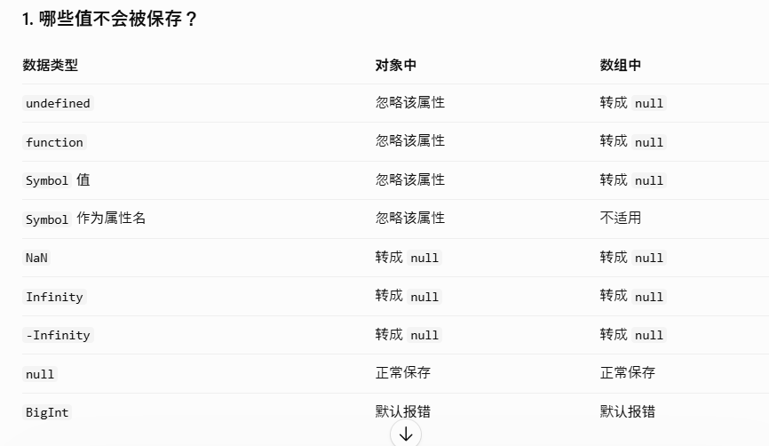
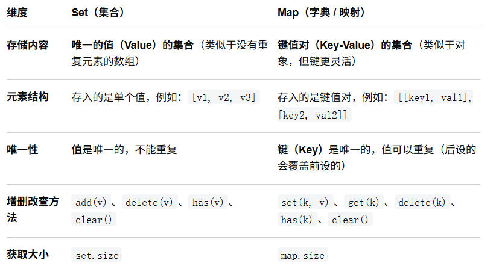
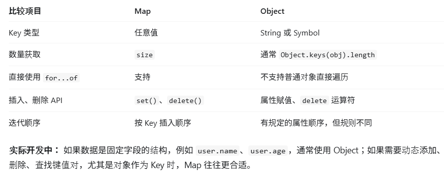

# 什么是原型链（Prototype Chain）？
JavaScript 中实现对象继承和属性/方法查找的核心机制。
## hasOwnProperty()
用于判断某个属性是否是该对象自身的属性（即直接定义在对象上的属性），而不会去查找该对象的原型链。
## instanceof()
instanceof 用于检测构造函数的 prototype 属性是否出现在某个实例对象的原型链上。
# 1.in 和 Object.hasOwn() 的区别
核心在于：检查属性时，是否会沿着原型链向上查找。
## 1.in：检查自身属性和继承属性
in 可以检查一个属性是否存在于对象自身或其原型链上。
```
const parent = {
  age: 20
};

const person = Object.create(parent);
person.name = "小明";

console.log("name" in person); // true
console.log("age" in person);  // true
console.log("toString" in person); // true
console.log("gender" in person);  // false
```
## 2.Object.hasOwn()：只检查自身属性
Object.hasOwn() 只检查属性是否直接存在于对象自身，不检查原型链。
```
const parent = {
  age: 20
};

const person = Object.create(parent);
person.name = "小明";

console.log(Object.hasOwn(person, "name")); // true
console.log(Object.hasOwn(person, "age"));  // false
console.log(Object.hasOwn(person, "toString")); // false
```

# 浅拷贝与深拷贝
如何实现浅拷贝`arr_copy = [...arr]`通过展开运算符 ... 将 user 自身的可枚举属性复制到一个新对象中。
**如何实现深拷贝？**
方法一：structuredClone()  
```
const user = {
    name: "张三",
    address: {
        city: "东京"
    }
};

const copy = structuredClone(user);

copy.address.city = "大阪";

console.log(user.address.city); // 东京
console.log(copy.address.city); // 大阪

console.log(
    user.address === copy.address
); // false
```
方法 2：JSON.parse(JSON.stringify())  
缺点是它只适合可安全进行 JSON 序列化的数据。例如 undefined 属性会丢失、Date 会转换成字符串、循环引用会报错，BigInt 也不能直接处理。
```
const user = {
    name: "张三",
    address: {
        city: "东京"
    }
};

const copy = JSON.parse(
    JSON.stringify(user)
);

copy.address.city = "大阪";

console.log(user.address.city); // 东京
```
# json序列化
JavaScript 中，JSON.stringify() 用于将 JavaScript 值转换为 JSON 字符串，但不是所有值都能被保存。最重要的是：undefined、function、Symbol 这三种值，在对象中会被忽略，在数组中则会变成 null。


# map()和set()的区别


## Map 与普通 Object 的区别
