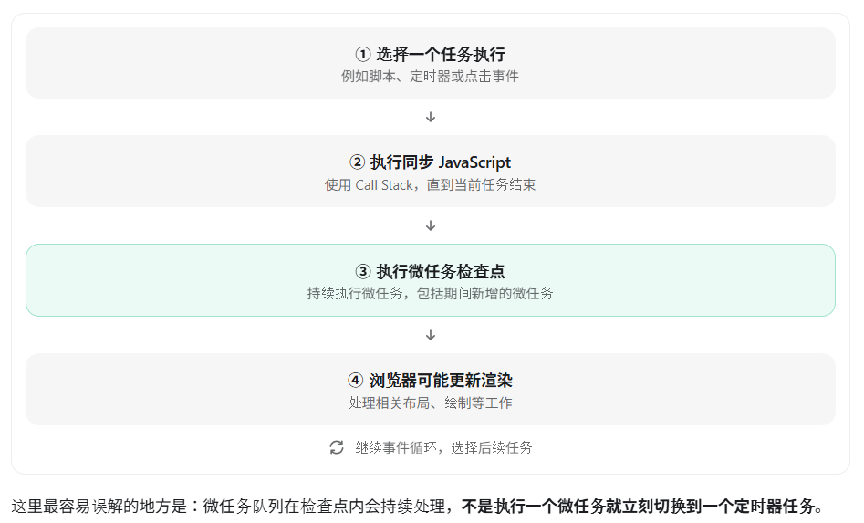
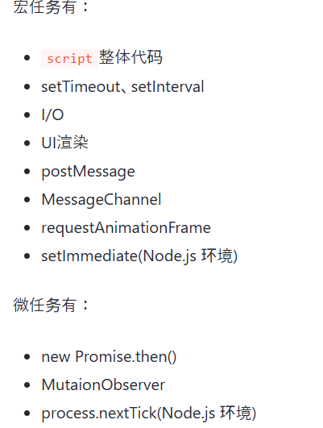
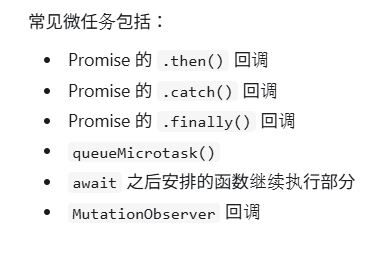

# 为什么JS不设计成多线程的
我们做个假设，如果JS是多线程的，因为JS有DOM API可以操作DOM，此时如果有两个线程在操作同一个DOM，线程1删除了这个dom节点，线程2要操作这个dom，就会产生矛盾，到底以哪个线程为主。为了避免这种情况的出现，JS就被设计成了单线程 。

# 什么是同步和异步？
## 同步（Synchronous）
同步代码通常按照代码顺序执行。
## 异步（Asynchronous）
异步机制允许某些操作在等待结果期间，不阻止后续 JavaScript 代码继续执行。
## 调用栈（Call Stack）
调用栈用于记录当前正在执行的函数。它遵循后进先出（LIFO） 的规则。  
异步回调也需要进入调用栈才能执行。 事件循环不会直接让 JavaScript 同时在一个调用栈中执行多个函数。

# 1.为什么需要异步处理
如果某段同步代码需要很长时间才能完成，后面的 JavaScript 只能等待。页面可能暂时无法响应点击、输入等操作，这种现象称为阻塞。

##  异步结果不能直接使用普通 return 取得,可以先通过回调函数接收结果
```
function loadCurrentUser(onSuccess) {
  setTimeout(() => {
    const user = { employeeNumber: "EMP-00001", name: "田中" };
    onSuccess(user);
  }, 500);
}

loadCurrentUser((user) => {
  console.log(user.name); // 田中
});
```

# 2.Promise 是什么
Promise 是 JavaScript 中用于表示一个异步操作最终完成或失败结果的对象。

## Promise 的三种状态
```
| 状态 | 含义 | 后续变化 |
|---|---|---|
| `pending` | 任务仍在处理中 | 可以变为成功或失败 |
| `fulfilled` | 任务成功完成 | 状态不会再改变 |
| `rejected` | 任务执行失败 | 状态不会再改变 |
```
Promise 从 pending 变为 fulfilled 或 rejected 后，状态就确定了。成功和失败不会同时发生，也不能再次改变。

## Promise是怎样创建和完成的
###  使用 new Promise() 创建 Promise
```
const promise = new Promise((resolve, reject) => {
    const success = true;

    if (success) {
        resolve("操作成功");
    } else {
        reject(new Error("操作失败"));
    }
});
```
### 用 resolve() 交付成功值,用.then获取结果
```
const task = new Promise((resolve) => {
  setTimeout(() => {
    resolve(["交通费申请", "休假申请"]);
  }, 500);
});

task.then((applications) => {
  console.log(applications);
});
```
### 用 reject() 交付失败原因,用.catch获取结果
```
const task = new Promise((resolve, reject) => {
  setTimeout(() => {
    reject(new Error("申请列表读取失败"));
  }, 500);
});

task.catch((error) => {
  console.error(error.message);
});
```
### finally() 执行共同收尾
无论前面的 Promise 成功还是失败都会执行，适合关闭加载提示、恢复按钮等操作。
```
console.log("显示加载中");

loadApplications("EMP-00001")
  .then((applications) => {
    console.log("读取成功", applications);
  })
  .catch((error) => {
    console.error("读取失败", error.message);
  })
  .finally(() => {
    console.log("关闭加载中");
  });
```
## Promise.then() 的链式调用
```
Promise.resolve(10)
    .then(value => {
        console.log(value);//10
        return value * 2;
    })
    .then(value => {
        console.log(value);//20
        return value + 5;
    })
    .then(value => {
        console.log(value);//25
    });
```
前一个 .then() 返回的值，通常会成为下一个 .then() 兑现时接收到的值。

# 3.async 和 await
## async 是什么？
async 用于声明异步函数。
```
async function getNumber() {
    return 10;
}

console.log(getNumber());
```
## await 是什么？
await 用于等待一个值（通常是 Promise）被解决，并获取其兑现结果。
```
async function test() {
    const result = await Promise.resolve(100);

    console.log(result);
}

test();
```

## 1.async 函数一定返回 Promise
```
async function getMessage() {
  return "读取完成";
}

const result = getMessage();
console.log(result); // Promise 对象

result.then((message) => {
  console.log(message); // 读取完成
});
```
## 2.await 取得 Promise 的成功值
```
async function showApplications() {
  const user = await loadCurrentUser();
  const applications = await loadApplications(user.employeeNumber);

  console.log(`${user.name}：`, applications);
}

showApplications();
```
Promise 成功时，await 表达式得到成功值。  
Promise 失败时，await 抛出失败原因。  

# 什么是 Event Loop？
JavaScript 的核心设计是单线程的（即同一时间只能做一件事情）。如果所有的任务（比如网络请求、文件读取、定时器）都按顺序同步执行，那么在等待这些操作返回结果时，整个页面或程序就会被“卡死”（阻塞）。为了让单线程能够处理异步操作，JavaScript 引入了 Event Loop，通过“主线程 + 任务队列”的协作方式，让耗时操作挂起，等有结果后再把回调函数送回主线程执行。

## 执行规则
```
所有代码作为宏任务进入主线程执行栈，开始执行
执行过程中，同步代码会立即执行，宏任务进入宏任务队列，微任务进入微任务队列
当前宏任务执行完成出队，读取微任务队列，有则执行，直至全部执行完毕
执行浏览器ui进程渲染
检查是否有webworker任务，有则执行
本轮宏任务执行完成，回到第2步，继续执行，直至宏任务与微任务队列全部清空
```
## Event Loop（事件循环）完整原理
Event Loop 的核心作用是协调 JavaScript 执行、任务、微任务以及浏览器渲染等工作。  


# 什么是宏任务和微任务？
  
这是理解 Event Loop 的核心。Task（任务），教学中常称为 Macrotask（宏任务）。Microtask（微任务）。
## 常见宏任务
```
setTimeout(() => {
    console.log("定时器执行");
}, 0);
```
宏任务不是严格意义上“所有任务只有一个全局 FIFO 队列”，浏览器可以有多个任务来源，调度还涉及其他规则。
## 常见微任务
```
Promise.resolve().then(() => {
    console.log("Promise 微任务");
});
```

# 为什么 setTimeout(..., 0) 不立即执行？
它表示请求一个非常短的定时延迟。回调仍然必须等待定时器调度以及事件循环后续选择任务执行。实际延迟还受到浏览器定时器限制、后台标签页策略、主线程繁忙程度等因素影响。