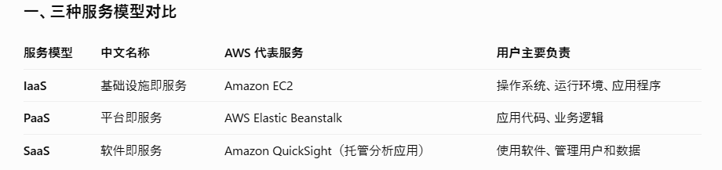
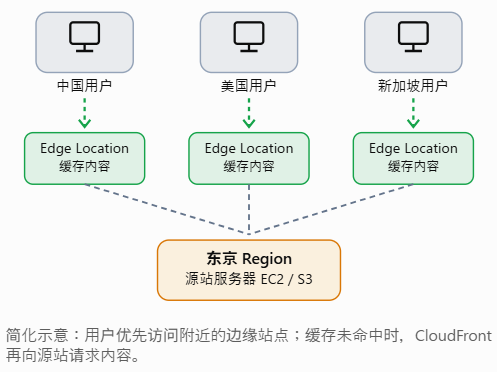
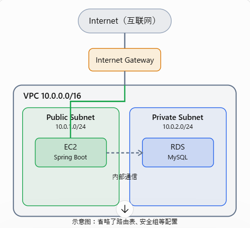
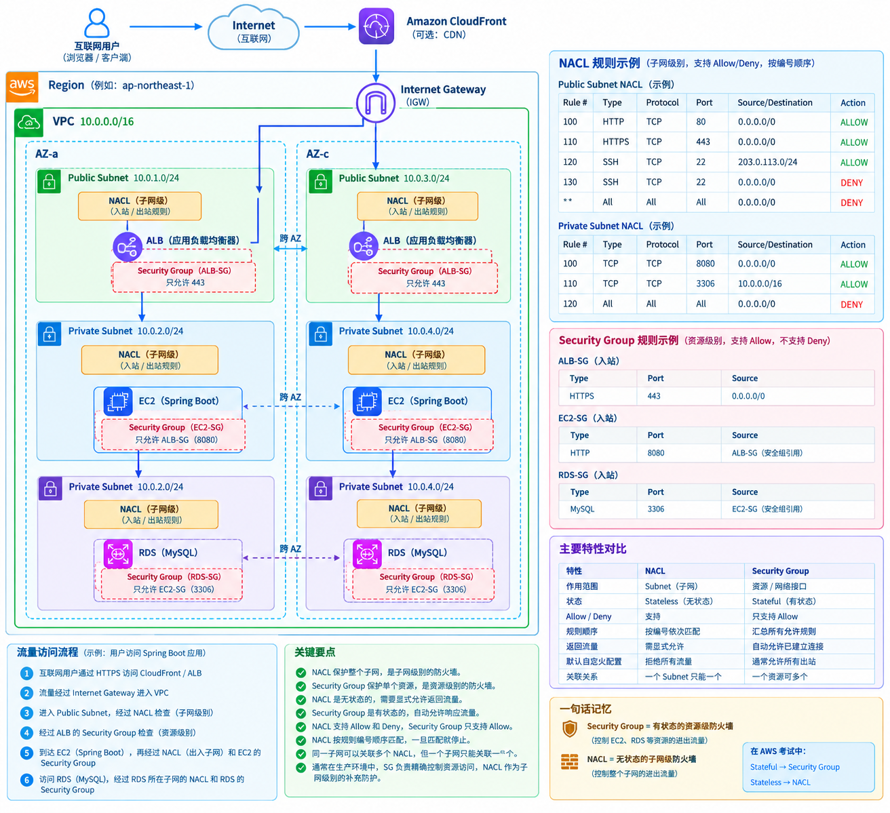
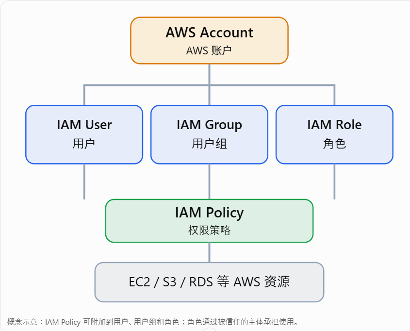
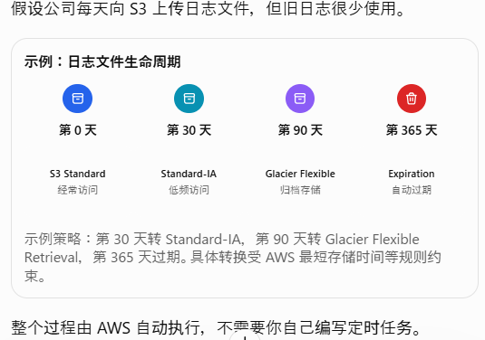
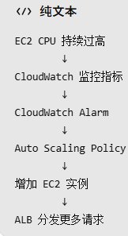
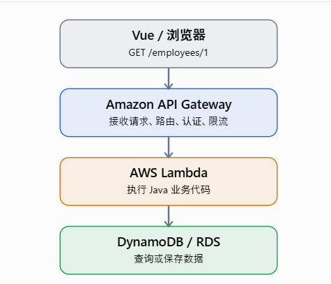

# AWS（Amazon Web Services）的三种经典云服务模型
IaaS（基础设施即服务），PaaS（平台即服务），SaaS（软件即服务）
## 三种服务模型对比

# AZ是什么
AZ 是 AWS 在一个 Region（区域）内部设置的、相互隔离的一个或多个数据中心。

## 为什么需要 AZ？
提高系统的可用性和容错能力。例：如果 AZ-a 出现故障，AZ-c 中的服务器仍然可以提供服务。Multi-AZ 主要用于高可用性，Multi-Region 还可用于跨区域灾难恢复。

# Edge Location（边缘站点）
Edge Location（边缘站点） 是 AWS 部署在世界各地、靠近终端用户的网络节点，主要用于加速内容分发、降低网络延迟。

## Edge Location 的工作原理
最典型的服务是**Amazon CloudFront**（CDN，内容分发网络）。假设你的网站部署在 AWS 东京 Region，而用户在中国、新加坡、美国访问这个网站。

# VPC 是什么？
VPC（Virtual Private Cloud，虚拟私有云） 是 AWS 提供的一种网络服务，允许你在 AWS 云中创建一个属于自己的、逻辑隔离的虚拟网络。VPC 就像你在 AWS 上建立了一个自己的局域网，可以控制服务器的 IP 地址、子网、路由和网络访问权限。
## VPC 的基本结构

## 子网（Subnet）
将 VPC 划分成更小的网络
### Public Subnet（公有子网）
路由表中有指向 Internet Gateway 的互联网路由。常用于部署面向互联网的负载均衡器、NAT Gateway 等资源。
### Private Subnet（私有子网）
没有直接指向 Internet Gateway 的互联网路由。常用于部署数据库、内部应用服务器等资源。
## 路由表（Route Table）
决定网络流量发往哪里
## Internet Gateway
为符合条件的资源提供互联网通信路径。用于让 VPC 内符合条件的资源与互联网进行通信。
## NAT Gateway
私有子网资源主动访问互联网。
## 安全组（Security Group）
Security Group 就是 EC2 服务器的防火墙，决定哪些网络请求可以进入服务器，以及服务器可以向哪里发送请求。
## AWS NACL（Network Access Control List）
NACL（网络访问控制列表） 是 AWS VPC 中的一种网络安全机制，用于控制 Subnet（子网）级别的入站和出站流量。NACL 作用于“子网级别”
## 完整流程图

# AWS IAM 是什么？
IAM（Identity and Access Management，身份与访问管理） 是 AWS 提供的一项安全服务，用来管理谁可以访问 AWS，以及可以执行哪些操作。
## IAM 的基本结构

### IAM User（用户）
一个可以被授权、被识别的主体（Principal）。例如创建一个用户 developer01，只允许他查看 EC2 和 S3。
### IAM Group（用户组）
Group 是一组 User 的集合，用于统一管理权限。
### IAM Role（角色）服务间授权
服务间授权。例如：你的 Spring Boot 程序部署在 EC2 上，需要访问 S3。可以给 EC2 关联一个具有 S3 权限的 IAM Role，应用通过临时凭证访问 S3，不需要把长期 Access Key 写在代码里。
### IAM Policy（策略）
IAM Policy（身份与访问管理策略） 是 AWS 中用来定义权限的一组规则，通常使用 JSON 格式编写。定义 AWS 操作权限。
#### Policy 的三要素？
AWS IAM Policy 的三大核心要素是：
1. Effect（效果）：允许（Allow）还是拒绝（Deny）。
2. Action（操作）：允许或拒绝执行什么 AWS API 操作，例如 s3:GetObject。
3. Resource（资源）：该操作针对哪个 AWS 资源，例如指定的 S3 Bucket。
### 最小权限原则
只授予用户、应用程序或服务完成工作所必需的最低权限，不提供多余权限。降低安全风险

#### EC2 为什么用 Role？
EC2 使用 IAM Role（角色），主要是为了让 EC2 上运行的应用程序安全地访问其他 AWS 服务，而不需要在代码中保存长期 Access Key（访问密钥）。AWS 自动提供和更新临时凭证。

# EC2 是什么？
EC2（Elastic Compute Cloud）是 AWS 提供的云服务器服务。
## 快照（Snapshot）是什么？
快照是 EBS 的备份机制，用于保存某一时间点的磁盘状态。快照是保护数据的重要手段。
## Key Pair
Key Pair 是 EC2 SSH 登录的唯一凭证。公钥在 AWS，私钥在本地
## 安全组（Security Group）
安全组（Security Group）是 EC2 使用的虚拟防火墙

# Nginx 是什么？
Nginx（读作 Engine-X） 是一款高性能的 Web 服务器、反向代理服务器和负载均衡器。Nginx 就像网站的入口管理员，负责接收用户请求，并决定把请求交给谁处理。

# AWS S3 是什么？
Amazon S3（Simple Storage Service，简单存储服务） 是 AWS 提供的一种对象存储服务（Object Storage），主要用于存储图片、视频、PDF、CSV、日志、备份文件等数据。

## S3 的基本结构
Bucket（存储桶）：用于存放对象的容器。
Object（对象）：实际存储的文件及其元数据。每一个文件 = 一个 Object
Key（对象键）：对象在 Bucket 中的唯一标识。

## AWS S3 生命周期规则
S3 Lifecycle Rules（生命周期规则） 是 AWS S3 提供的自动化管理功能，可以根据对象的存储时间，自动执行转换存储类别或删除对象等操作。比如：文件刚上传时使用高性能存储，时间久了自动转到便宜的存储类别，最后自动删除，从而降低存储成本。
### 生命周期规则的工作原理

# RDS（关系型数据库服务）
Amazon RDS（Relational Database Service，关系型数据库服务） 是 AWS 提供的一种托管式关系型数据库服务。RDS 支持自动存储扩容
## RDS 应该部署在哪里？
RDS 部署在私网子网（Private Subnet）中。只允许应用服务器访问

# AWS ALB是什么
ALB（Application Load Balancer，应用程序负载均衡器） 是 AWS 提供的一种工作在 OSI 第 7 层（应用层） 的负载均衡服务，主要用于分发 HTTP 和 HTTPS 请求。ALB 就像网站的流量调度员，把用户请求分配给不同的后端服务器，避免所有请求集中到一台 EC2 上。
## ALB 的五个核心功能
### Load Balancing（负载均衡）
ALB 可以将请求分发给多个后端目标。
### Health Check（健康检查）
ALB 会定期检查后端服务器是否正常。
### Path-based Routing（路径路由）
ALB 可以根据 URL 路径，将请求分配到不同的 Target Group。
### Host-based Routing（域名路由）
根据域名转发请求。

例如：
- api.example.com → API 服务
- admin.example.com → 管理后台
- shop.example.com → 商城服务
### HTTPS Termination（HTTPS 终止）
ALB 可以使用 AWS Certificate Manager（ACM）提供的证书处理 HTTPS。
#### AWS ACM
ACM（AWS Certificate Manager，AWS 证书管理器） 是 AWS 提供的一项服务，用于申请、管理、部署和自动续订 SSL/TLS 证书。ACM 就是帮你管理 HTTPS 证书的服务，让网站能够安全地使用 HTTPS。

## AWS Auto Scaling（自动扩缩容）
Auto Scaling（自动扩缩容） 是 AWS 根据系统负载或预设计划，自动增加或减少计算资源的功能。访问量大时自动增加服务器，访问量小时自动减少服务器，既保证性能，又控制成本。

# AWS CloudWatch
Amazon CloudWatch 是 AWS 提供的监控与可观测性服务（Monitoring and Observability），用于收集系统指标、日志，监控 AWS 资源和应用程序的运行状态，并在出现异常时触发告警或自动化操作。
## CloudWatch 的四个核心功能
### Metrics（指标）
Metrics 是可以用数字表示的监控数据。比如：EC2 CPU 使用率
### Logs（日志）
CloudWatch Logs 用来集中保存和查询日志。
### Alarms（告警）
CloudWatch Alarm 根据监控指标是否达到条件来改变告警状态，并可以触发通知或自动化操作。
### Dashboards（监控仪表盘）
Dashboard 可以把多个指标放在一个页面上。
## CloudWatch 和 Auto Scaling 的关系
你之前学习的 Auto Scaling 可以利用 CloudWatch 指标和告警进行扩缩容。

# AWS Lambda
AWS Lambda 是 AWS 提供的一种无服务器计算服务（Serverless Compute），可以在特定事件发生时自动运行代码，而不需要你自己创建、管理 EC2 服务器。
## AWS Lambda 与 API Gateway 如何配合
API Gateway 负责接收和管理 HTTP 请求，Lambda 负责执行后端业务逻辑。
### 整体工作流程

# AWS Secrets Manager
AWS Secrets Manager 是 AWS 提供的一种托管服务，用于安全地存储、读取和轮换敏感信息（Secrets）。Secrets Manager 管理密码，IAM 管理访问权限，KMS 管理加密密钥，CloudTrail 记录操作历史。

# Route 53
Amazon Route 53 是 AWS 提供的一项高可用、可扩展的 DNS（Domain Name System，域名系统）服务。