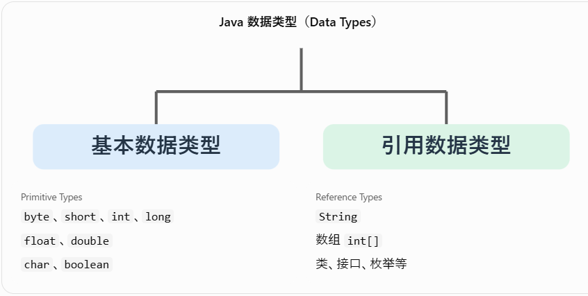
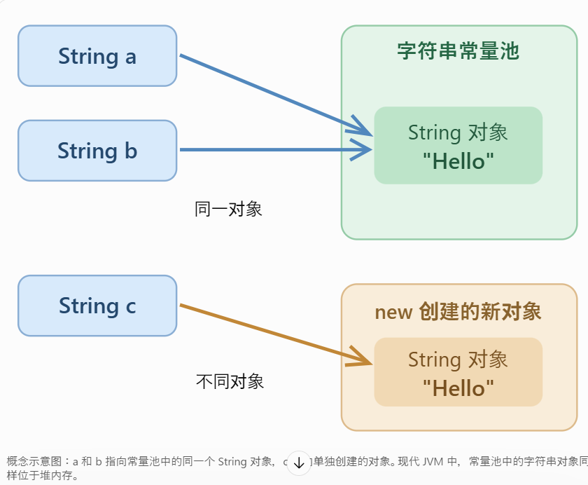
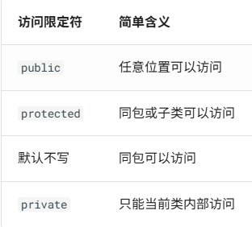
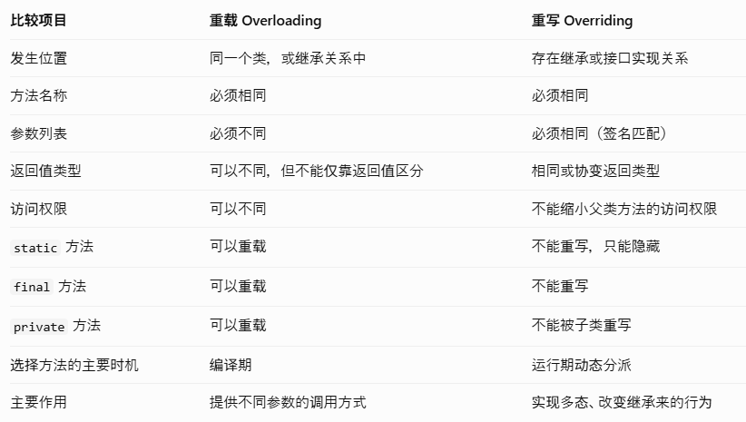
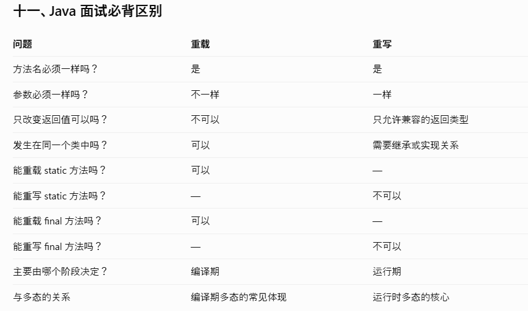
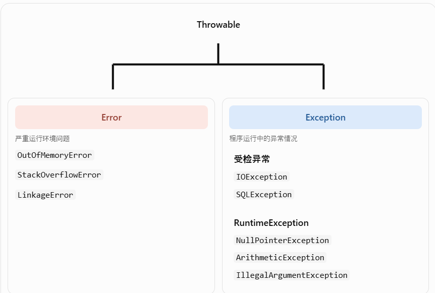
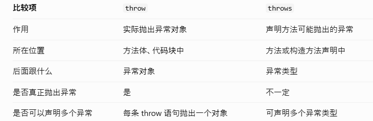
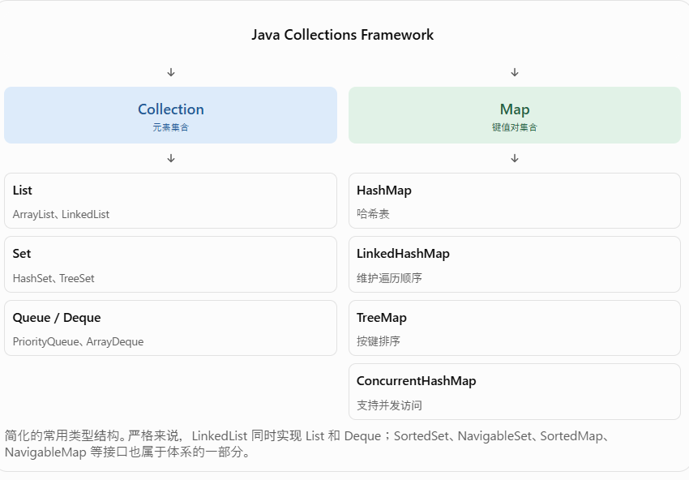

# java的数据类型


# String 类型详解
## String 的创建方式
1. 使用双引号创建  2. 使用 new 创建

## String 的不可变性
String 是不可变对象，一旦创建，其字符内容就不能改变。

## 与string相关的方法
### split()分割字符串
```
public class main {
    public static void main(String[] args) {

        String str = "Java  Spring    React";

        String[] result = str.split("\\s+");//按照一个或多个空白来分割字符串

        System.out.println(result[0]); // Java
        System.out.println(result[1]); // Spring
        System.out.println(result[2]); // React

        System.out.println(result.length); // 3
    }
}
```
### trim()删除字符串开头和结尾处的空格
常可以理解为删除首尾的普通空格、制表符、换行等字符。
```
public class main {
    public static void main(String[] args) {

        String str = "	  S	pring   ";
        String str2 = str.trim();
        System.out.println(str2.length());//7
        System.out.println(str2);//S	pring
    }
}
```
### strip()
它用于删除字符串首尾由 Character.isWhitespace() 识别的 Unicode 空白字符。
相比 trim()，strip() 能识别更多现代文本中常见的空白字符，例如全角空格。
```
public class main {
    public static void main(String[] args) {

    	String str = "　Java　";

    	System.out.println("[" + str.trim() + "]");
    	System.out.println("[" + str.strip() + "]");
    	
    }
}
```
### replace()
将字符串中的指定字符或指定内容替换为新的内容。
```
public class main {
    public static void main(String[] args) {

    	String str = "Hello Java";
    	String str2 = str.replace("Java", "Spring");
    	
    	System.out.println(str2);
    }
}
```
### String.valueOf() 常用于把其他类型转换成字符串。

# Java 类的访问限定符
Java 中常见的访问限定符有 4 种访问级别：public,protected,default,private  
如果是普通的顶层类（Top-level Class），只能使用 public 或默认访问权限。


# Java 中 abstract、final、static 修饰类的区别
abstract（抽象类）：不能直接创建对象，可以被继承，主要用于定义公共结构和行为。  
final（最终类）：可以创建对象，但不允许其他类继承。  
static（静态成员类）：用于嵌套在其他类内部的成员类，创建对象时不需要外部类实例。普通顶级类不能使用 static 修饰。  

# Java 成员变量中的 static、final、static final 详解
static：变量属于类，所有对象共享同一个变量。  
final：变量只能被赋值一次，赋值完成后不能重新赋值。  
static final：变量属于类，并且只能赋值一次，通常用于定义常量。  

# Java 方法修饰符：static、final、static final 详解
static 方法：属于类本身，可以直接通过类名调用，不需要创建对象。  
final 方法：不能被子类重写（Override），但是可以被继承和调用。  
static final 方法：既是静态方法，又禁止子类隐藏（Hide）该方法。  

# 方法的重载（Overloading）与重写（Overriding）详解
重载（Overloading）：方法名相同，参数列表不同。根据传入的参数决定调用哪个方法。  
重写（Overriding）：子类重新实现父类允许重写的实例方法。根据运行时对象类型决定实际执行哪个实现。  


## 重载成立的条件
### 参数数量不同
```
public void print(String name) {
    System.out.println(name);
}

public void print(String name, int age) {
    System.out.println(name + age);
}
```
### 参数类型不同
```
public void print(int number) {
    System.out.println(number);
}

public void print(String text) {
    System.out.println(text);
}
```
### 参数顺序不同
```
public void show(String name, int age) {
    System.out.println(name + age);
}

public void show(int age, String name) {
    System.out.println(age + name);
}
```
## 哪些情况不构成方法重载？
### 仅返回值不同，不构成重载
### 仅访问修饰符不同，不构成重载
### 仅参数名称不同，不构成重载


# instanceof 详解
instanceof 是 Java 中用于判断一个对象是否属于某种类型的运算符。instanceof 不只是判断对象是否属于某个具体类，也能判断是否属于它的父类或实现的接口。

# Java 异常处理（Exception Handling）完整详解
## Java 异常体系（Throwable）

Error 一般表示 JVM、类加载或运行环境中发生了严重问题。  
Exception 表示程序执行中需要考虑和处理的异常情况。  
RuntimeException 是 Exception 的子类，代表非受检异常的一大类。  
## throw 和 throws 的区别

### throw：主动抛出异常
```
public class UserService {

    public void register(int age) {

        if (age < 18) {

            throw new IllegalArgumentException(
                "年龄不能小于18岁"
            );
        }

        System.out.println("注册成功");
    }
}
```
### throws：声明可能抛出异常
```
import java.io.IOException;

public class FileService {

    public void readFile() throws IOException {

        throw new IOException("文件读取失败");
    }
}
```
## try-with-resources
传统写法一般要使用 finally 来保证关闭资源。
```
import java.io.BufferedReader;
import java.io.IOException;
import java.nio.charset.StandardCharsets;
import java.nio.file.Files;
import java.nio.file.Path;

public class Main {

    public static void main(String[] args) {

        try (BufferedReader reader = Files.newBufferedReader(
                Path.of("employee.csv"),
                StandardCharsets.UTF_8
        )) {

            String line;

            while ((line = reader.readLine()) != null) {
                System.out.println(line);
            }

        } catch (IOException e) {

            System.out.println("文件读取失败");
        }
    }
}
```
当 try 结束时，Java 会自动调用资源的 close() 方法。
# java的集合框架

## List 接口
元素有顺序。允许重复元素。
```
import java.util.ArrayList;
import java.util.List;

public class Main {

    public static void main(String[] args) {

        List<String> names = new ArrayList<>();

        // 添加
        names.add("田中");
        names.add("佐藤");
        names.add("鈴木");

        // 指定位置插入
        names.add(1, "山田");

        // 获取
        System.out.println(names.get(0));

        // 修改
        names.set(0, "高橋");

        // 删除
        names.remove("佐藤");

        // 判断是否存在
        System.out.println(names.contains("鈴木"));

        // 获取大小
        System.out.println(names.size());

        // 遍历
        for (String name : names) {
            System.out.println(name);
        }
    }
}
```
## Set 接口
不允许存在重复元素。判断唯一性依赖 hashCode() 与 equals()无索引，不支持随机访问
## Queue 队列
先进先出（FIFO，First In First Out）。主要用于管理等待处理的任务或元素。
## Map
Key 不能重复。Value 可以重复。
### List.of()
创建的是不可修改的列表。