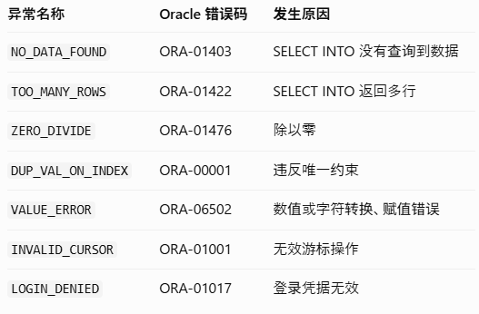

# SQL 和 PL/SQL 的区别
SQL 是数据库查询和操作语言，而 PL/SQL 是 Oracle 在 SQL 基础上扩展出来的过程式编程语言。  
SQL：告诉数据库“我要做什么”。  
PL/SQL：告诉数据库“按照什么顺序执行、如何判断条件、如何循环、发生错误怎么办”。

# 变量定义
```
declare
SUBTYPE employee_id_type is number(10);//预定义子类型
subtype employee_age_type is number(3);

v_employee_id employee_id_type := 1001;
v_employee_age employee_age_type := 17;
begin
if v_employee_age not between 18 and 65 then
raise_application_error(-20001, '年龄必须在18到65之间');
end if;
DBMS_OUTPUT.put_line('员工编号' || v_employee_id);
dbms_output.put_line('员工年龄' || v_employee_age);
end;
/
```
声明部分（DECLARE）（可选） 定义变量、游标、常量、子程序等。  
可执行部分（BEGIN … END）（必须） 编写可执行的 PL/SQL 与 SQL 语句。  
异常处理部分（EXCEPTION）（可选） 处理运行时异常。  

计数、ID：PLS_INTEGER  
金额、精度计算：NUMBER(p,s)  
字符串统一用varchar2  

## boolean
### 为什么 BOOLEAN 有三个值？
因为数据库中存在 NULL，它表示未知，而不是 FALSE。
**Oracle 23c 之前的 BOOLEAN 使用限制,SQL 层不支持 BOOLEAN 数据类型。需要注意：从 Oracle Database 23c（后续版本包括 23ai） 开始，SQL 也支持 BOOLEAN 数据类型了。**
```
declare
v_salary number := 350000;
v_years number := 3;

v_is_active boolean := true;
v_can_get_bonus boolean;

begin
v_can_get_bonus := v_is_active and v_salary >= 300000 and v_years >= 2;
if v_can_get_bonus then
dbms_output.put_line('ok');
ELSIF not v_can_get_bonus then
dbms_output.put_line('no');
else
dbms_output.put_line('null');
end if;
end;
/
```

## PL/SQL 常量（CONSTANT）
`pi constant number := 3.141592654;`

# SELECT INTO
```
DECLARE
    v_name EMPLOYEES.NAME%TYPE;
    v_salary EMPLOYEES.SALARY%TYPE;
BEGIN
    SELECT NAME, SALARY
    INTO v_name, v_salary
    FROM EMPLOYEES
    WHERE ID = 100;

    DBMS_OUTPUT.PUT_LINE('员工姓名：' || v_name);
    DBMS_OUTPUT.PUT_LINE('工资：' || v_salary);

EXCEPTION
    WHEN NO_DATA_FOUND THEN
        DBMS_OUTPUT.PUT_LINE('员工不存在');

    WHEN TOO_MANY_ROWS THEN
        DBMS_OUTPUT.PUT_LINE('查询到多个员工');
END;
/
```
SELECT 列数 必须与 INTO 变量数量一致,查询结果 必须且只能返回一行。

# 流程控制

## 条件控制（IF / CASE）
### IF ELSIF ELSE
```
DECLARE
    v_salary NUMBER := 350000;
BEGIN
    IF v_salary >= 500000 THEN
        DBMS_OUTPUT.PUT_LINE('高工资');

    ELSIF v_salary >= 300000 THEN
        DBMS_OUTPUT.PUT_LINE('中等工资');

    ELSE
        DBMS_OUTPUT.PUT_LINE('低工资');
    END IF;
END;
/
```
### CASE 条件判断
#### 简单 CASE（Simple CASE）
```
declare
v_status varchar2(20) := 'ACTIVE';
begin
case v_status
when 'ACTIVE' then
dbms_output.put_line('在职');
WHEN 'INACTIVE' THEN
DBMS_OUTPUT.PUT_LINE('离职');
WHEN 'LEAVE' THEN
DBMS_OUTPUT.PUT_LINE('休假');
ELSE 
dbms_output.put_line('未知状态');
end case;
end;
/
```
#### 搜索 CASE（Searched CASE）
```
DECLARE
    v_salary NUMBER := 350000;
BEGIN
    CASE
        WHEN v_salary >= 500000 THEN
            DBMS_OUTPUT.PUT_LINE('高工资');

        WHEN v_salary >= 300000 THEN
            DBMS_OUTPUT.PUT_LINE('中等工资');

        ELSE
            DBMS_OUTPUT.PUT_LINE('低工资');
    END CASE;
END;
/
```

## LOOP 循环
### 基本 LOOP
```
DECLARE
v_count number := 1;
begin
loop
dbms_output.put_line(v_count);
v_count := v_count + 1;
exit when v_count > 5;
end loop;
end;
/
```
WHILE 的特点：先判断条件，再执行循环。
```
DECLARE
    v_count NUMBER := 1;
BEGIN
    WHILE v_count <= 5 LOOP
        DBMS_OUTPUT.PUT_LINE(v_count);

        v_count := v_count + 1;
    END LOOP;
END;
/
```
### FOR LOOP
```
BEGIN
    FOR i IN 1..5 LOOP
        DBMS_OUTPUT.PUT_LINE(i);
    END LOOP;
END;
/
```

# 异常处理
异常处理（Exception Handling） 用于捕获程序运行过程中发生的错误，并执行相应的处理逻辑，避免程序因为错误而直接中断。
## 基本语法
```
DECLARE
    -- 声明变量
BEGIN
    -- 正常执行的代码

EXCEPTION
    WHEN 异常名称 THEN
        -- 异常处理代码

    WHEN OTHERS THEN
        -- 处理其他异常
END;
/
```
## Oracle 常见的预定义异常


## WHEN OTHERS（兜底异常）
```
exception
  when others then
    dbms_output.put_line('Error code=' || sqlcode);
    dbms_output.put_line('Error msg='  || sqlerrm);
    raise;
end;
```
完整示例：
```
DECLARE
v_id EMPLOYEES.ID%TYPE := 100;
v_new_salary EMPLOYEES.salary%type := 350000;
V_old_salary EMPLOYEES.salary%type;
begin
select SALARY
into v_old_salary 
from EMPLOYEES
WHERE ID = v_id;

dbms_output.put_line('原工资' || v_old_salary);

if v_new_salary < 0 then
    raise_application_error(-20001, '工资不能小于0');
end if;

update employees
set salary = v_new_salary
where id = v_id;

commit;

dbms_output.put_line('工资修改为了:' || v_new_salary);

exception
when no_data_found then
rollback;
dbms_output.put_line('员工不存在');
when others then
rollback;
dbms_output.put_line('code：' || sqlcode);
dbms_output.put_line('message:' || sqlerrm);
raise;//将异常继续向外抛出

end;
/
```
## 用户自定义异常（业务异常）
```
SET SERVEROUTPUT ON;

DECLARE
    v_id EMPLOYEES.ID%TYPE := 100;
    v_new_salary EMPLOYEES.SALARY%TYPE := -1;
    v_old_salary EMPLOYEES.SALARY%TYPE;

    -- ① 声明用户自定义异常
    e_invalid_salary EXCEPTION;

BEGIN
    -- 查询原工资
    SELECT SALARY
    INTO v_old_salary
    FROM EMPLOYEES
    WHERE ID = v_id;

    DBMS_OUTPUT.PUT_LINE('原工资：' || v_old_salary);

    -- ② 检查工资
    IF v_new_salary IS NULL OR v_new_salary < 0 THEN
        RAISE e_invalid_salary;
    END IF;

    -- 工资合法才更新
    UPDATE EMPLOYEES
    SET SALARY = v_new_salary
    WHERE ID = v_id;

    COMMIT;

    DBMS_OUTPUT.PUT_LINE('工资修改成功');

EXCEPTION
    WHEN NO_DATA_FOUND THEN
        ROLLBACK;
        DBMS_OUTPUT.PUT_LINE('员工不存在');

    -- ③ 捕获自定义异常
    WHEN e_invalid_salary THEN
        ROLLBACK;
        DBMS_OUTPUT.PUT_LINE('工资不能为负数或NULL');

    WHEN OTHERS THEN
        ROLLBACK;
        DBMS_OUTPUT.PUT_LINE('其他异常：' || SQLERRM);
        RAISE;
END;
/
```
e_error EXCEPTION;  -- 声明  
RAISE e_error;      -- 触发  
WHEN e_error THEN   -- 捕获  
## RAISE_APPLICATION_ERROR
RAISE_APPLICATION_ERROR 是 Oracle PL/SQL 提供的一个内置过程，用来主动抛出带有错误编号和错误信息的业务异常。
```
SET SERVEROUTPUT ON;

DECLARE
    v_id EMPLOYEES.ID%TYPE := 100;
    v_new_salary EMPLOYEES.SALARY%TYPE := -1;
    v_old_salary EMPLOYEES.SALARY%TYPE;

BEGIN
    SELECT SALARY
    INTO v_old_salary
    FROM EMPLOYEES
    WHERE ID = v_id;

    DBMS_OUTPUT.PUT_LINE('原工资：' || v_old_salary);

    -- 检查新工资是否合法
    IF v_new_salary IS NULL OR v_new_salary < 0 THEN
        RAISE_APPLICATION_ERROR(
            -20001,
            '工资不能为负数或NULL'
        );
    END IF;

    UPDATE EMPLOYEES
    SET SALARY = v_new_salary
    WHERE ID = v_id;

    COMMIT;

    DBMS_OUTPUT.PUT_LINE('工资修改成功');

EXCEPTION
    WHEN NO_DATA_FOUND THEN
        DBMS_OUTPUT.PUT_LINE('员工不存在');

    WHEN OTHERS THEN
        DBMS_OUTPUT.PUT_LINE('错误编号：' || SQLCODE);
        DBMS_OUTPUT.PUT_LINE('错误信息：' || SQLERRM);
        RAISE;
END;
/
```
## 日志与自治事务
业务执行失败后需要 ROLLBACK，但我们希望错误日志仍然保存在数据库中。
### 什么是自治事务？
自治事务是 Oracle 提供的一种独立事务机制。它允许一个 PL/SQL 子程序在调用者事务尚未结束时，独立执行 COMMIT 或 ROLLBACK。
自治事务的提交不会提交主事务；主事务的回滚也不会撤销已经提交的自治事务。
#### 第一步：创建日志表
```
CREATE TABLE ERROR_LOG (
    LOG_ID NUMBER GENERATED ALWAYS AS IDENTITY PRIMARY KEY,
    ERROR_CODE NUMBER,
    ERROR_MESSAGE VARCHAR2(2000),
    CREATED_AT TIMESTAMP DEFAULT SYSTIMESTAMP
);
```
#### 第二步：创建自治事务日志过程
```
CREATE OR REPLACE PROCEDURE WRITE_ERROR_LOG (//创建存储过程
    p_error_code IN NUMBER,
    p_error_message IN VARCHAR2
)
AS
    PRAGMA AUTONOMOUS_TRANSACTION;//声明该过程使用自治事务
BEGIN
    INSERT INTO ERROR_LOG (
        ERROR_CODE,
        ERROR_MESSAGE
    )
    VALUES (
        p_error_code,
        p_error_message
    );

    COMMIT;

EXCEPTION
    WHEN OTHERS THEN
        ROLLBACK;
        RAISE;
END;
/
```
#### 第三步：执行工资更新业务
```
SET SERVEROUTPUT ON;

DECLARE
    v_id EMPLOYEES.ID%TYPE := 100;
    v_new_salary EMPLOYEES.SALARY%TYPE := 500000;

    v_error_code NUMBER;
    v_error_message VARCHAR2(2000);

BEGIN
    -- ① 更新工资
    UPDATE EMPLOYEES
    SET SALARY = v_new_salary
    WHERE ID = v_id;

    IF SQL%ROWCOUNT = 0 THEN
        RAISE_APPLICATION_ERROR(-20002, '员工不存在');
    END IF;

    DBMS_OUTPUT.PUT_LINE('工资已更新，但尚未提交');

    -- ② 模拟业务错误
    RAISE_APPLICATION_ERROR(-20001, '模拟工资处理失败');

    COMMIT;

EXCEPTION
    WHEN OTHERS THEN
        -- ③ 保存异常信息
        v_error_code := SQLCODE;
        v_error_message := SQLERRM;

        -- ④ 调用自治事务记录日志
        WRITE_ERROR_LOG(
            v_error_code,
            v_error_message
        );

        -- ⑤ 回滚主事务
        ROLLBACK;

        DBMS_OUTPUT.PUT_LINE('工资修改已回滚');
        DBMS_OUTPUT.PUT_LINE('错误日志已保存');
END;
/
```
### 自治事务的重要注意事项 
自治事务执行了 DML 后，必须通过 COMMIT 或 ROLLBACK 结束事务，才能正常返回调用者。  
日志失败也需要考虑  
### 普通事务日志和自治事务日志的区别


