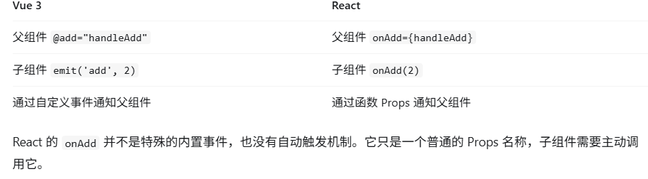
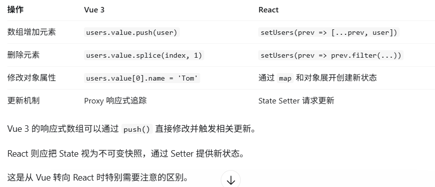

# 响应事件
使用 React 可以在 JSX 中添加 事件处理函数。
```
export default function Button() {
  function handleClick() {
    alert('你点击了我！');
  }

  return (
    <button onClick={handleClick}>
      点我
    </button>
```

# 组件记忆
局部变量无法在多次渲染中持久保存。 当 React 再次渲染这个组件时，它会从头开始渲染——不会考虑之前对局部变量的任何更改。更改局部变量不会触发渲染。 React 没有意识到它需要使用新数据再次渲染组件。

# hook是什么
Hook 是 React 提供的一组特殊函数，让函数组件能够“接入” React 的状态、生命周期等功能。  
在 React 中，useState 以及任何其他以“use”开头的函数都被称为 Hook。
Hook 必须在组件函数或自定义 Hook 的最外层调用，不能让 if / for / 普通函数 决定 Hook 是否执行。

# 渲染和提交
渲染必须始终是一次纯计算。
对于初次渲染，React 会使用 appendChild() DOM API 将其创建的所有 DOM 节点放在屏幕上。  
对于重渲染，React 将应用最少的必要操作（在渲染时计算！），以使得 DOM 与最新的渲染输出相互匹配。  
React 仅在渲染之间存在差异时才会更改 DOM 节点。 

## 设置 state 只会为下一次渲染变更 state 的值。
```
import { useState } from 'react';

export default function Counter() {
  const [number, setNumber] = useState(0);

  return (
    <>
      <h1>{number}</h1>
      <button onClick={() => {
        setNumber(number + 1);
        setNumber(number + 1);
        setNumber(number + 1);
      }}>+3</button>
    </>
  )
}
```
在本次渲染过程中number的值始终为0；

## 一个 state 变量的值永远不会在一次渲染的内部发生变化， 即使其事件处理函数的代码是异步的。
React 会使 state 的值始终“固定”在一次渲染的各个事件处理函数内部。  

## 在下次渲染前多次更新同一个 state
```
import { useState } from 'react';

export default function Counter() {
  const [number, setNumber] = useState(0);

  return (
    <>
      <h1>{number}</h1>
      <button onClick={() => {
        setNumber(n => n + 1);
        setNumber(n => n + 1);
        setNumber(n => n + 1);
      }}>+3</button>
    </>
  )
}
```
n => n + 1 被称为更新函数。
```
import { useState } from 'react';

export default function Counter() {
  const [number, setNumber] = useState(0);

  return (
    <>
      <h1>{number}</h1>
      <button onClick={() => {
        setNumber(number + 5);
        setNumber(n => n + 1);
      }}>增加数字</button>
    </>
  )
}
```
1.setNumber(number + 5)：number 为 0，所以 setNumber(0 + 5)。React 将 “替换为 5” 添加到其队列中。  
2.setNumber(n => n + 1)：n => n + 1 是一个更新函数。 React 将 该函数 添加到其队列中。  

## 更新 state 中的对象
当你想要更新一个对象时，你需要创建一个新的对象（或者将其拷贝一份），然后将 state 更新为此对象。不能只更新对象中的属性。

## Immer
由 Immer 提供的 draft 是一种特殊类型的对象，被称为 Proxy，它会记录你用它所进行的操作。这就是你能够随心所欲地直接修改对象的原因所在！从原理上说，Immer 会弄清楚 draft 对象的哪些部分被改变了，并会依照你的修改创建出一个全新的对象。
```
import { useImmer } from 'use-immer';

export default function Form() {
  const [person, updatePerson] = useImmer({
    name: 'Niki de Saint Phalle',
    artwork: {
      title: 'Blue Nana',
      city: 'Hamburg',
      image: 'https://react.dev/images/docs/scientists/Sd1AgUOm.jpg',
    }
  });

  function handleNameChange(e) {
    updatePerson(draft => {
      draft.name = e.target.value;
    });
  }

  function handleTitleChange(e) {
    updatePerson(draft => {
      draft.artwork.title = e.target.value;
    });
  }

  function handleCityChange(e) {
    updatePerson(draft => {
      draft.artwork.city = e.target.value;
    });
  }

  function handleImageChange(e) {
    updatePerson(draft => {
      draft.artwork.image = e.target.value;
    });
  }

  return (
    <>
      <label>
        Name:
        <input
          value={person.name}
          onChange={handleNameChange}
        />
      </label>
      <label>
        Title:
        <input
          value={person.artwork.title}
          onChange={handleTitleChange}
        />
      </label>
      <label>
        City:
        <input
          value={person.artwork.city}
          onChange={handleCityChange}
        />
      </label>
      <label>
        Image:
        <input
          value={person.artwork.image}
          onChange={handleImageChange}
        />
      </label>
      <p>
        <i>{person.artwork.title}</i>
        {' by '}
        {person.name}
        <br />
        (located in {person.artwork.city})
      </p>
      
    </>
  );
}
```

# Props 是 React 组件之间传递数据的主要方式，与vue有何不同？
在 Vue 3 中：`const count = ref(0)`count 是一个 Ref 对象，可以通过 count.value 访问数据。
但在 React 中：`const [count, setCount] = useState(0)`count 是当前渲染所得到的数字，而不是 Ref 对象。因此：`<Child count={count} />`传递的是当前渲染的 count 值。vue传递的是ref对象。

# 为什么 Props 是只读的？
React 遵循单向数据流（One-way Data Flow）。

# React 的回调函数传递是什么？
```
<Child
    count={count}
    onAdd={handleAdd}
/>
```
表示把 handleAdd 这个函数引用传递给子组件。  

与 Vue 的对比：  


# 什么时候应该把 State 放到父组件？
这涉及 React 一个非常重要的设计原则：状态提升（Lifting State Up）。假设有两个子组件，都需要显示相同的 count。推荐父组件集中管理：
```
function Parent() {
    const [count, setCount] = useState(0)

    return (
        <>
            <ChildA count={count} />
            <ChildB count={count} />

            <button
                onClick={() => setCount(c => c + 1)}
            >
                增加
            </button>
        </>
    )
}
```
**只有一个组件需要的状态，可以留在该组件；多个组件需要共享的状态，通常提升到它们最近的共同父组件。**

# React 中如何实现类似 Vue v-if 的条件渲染？
方法一：if / else  
```
function UserStatus({ isLoggedIn }) {
    if (isLoggedIn) {
        return <h2>欢迎回来</h2>
    } else {
        return <h2>请先登录</h2>
    }
}
```
方法二：三元运算符
```
function UserStatus({ isLoggedIn }) {
    return (
        <h2>
            {isLoggedIn ? '欢迎回来' : '请先登录'}
        </h2>
    )
}
```
方法三：&& 运算符
```
function Notification({ count }) {
    return (
        <div>
            {count > 0 && (
                <p>存在 {count} 条通知</p>
            )}
        </div>
    )
}
```

# 为什么 React State 中的数组不能直接使用 push()？
`setLogs(prev => [...prev, 'A'])`为什么不直接写：`logs.push('A')`React 的 State 应当作为不可变的数据来处理。更新数组时，应该创建一个新数组，而不是直接修改原数组。React 不会仅因为数组内部被修改，就自动知道应该重新渲染组件。  
正确方式：创建新数组  
```
setLogs([...logs, 'A'])
```

## React 与 Vue 的数组更新区别


# createContext() 与 useContext()
createContext() 和 useContext() 是 React 中实现跨层级组件数据共享的两个重要 API。
# createContext()：创建上下文
```
import { createContext } from 'react'

export const UserContext = createContext('Guest')
```
表示创建一个 Context，其默认值为 "Guest"。`createContext()` 本身不会创建响应式状态，也不会保存一个可以随意修改的全局变量。它的作用是创建一个供 Provider 和消费者共同使用的上下文标识。
# Provider：提供共享数据
```
import { UserContext } from './UserContext'
import Layout from './Layout'

export default function App() {
    return (
        <UserContext.Provider value="Tom">
            <Layout />
        </UserContext.Provider>
    )
}
```
我向这个 Provider 下方的所有后代组件提供 "Tom" 这个值。value 是 Provider 的关键属性。`<UserContext.Provider value="Tom">`我向这个 Provider 下方的所有后代组件提供 "Tom" 这个值。

# useContext()：读取共享数据
```
import { useContext } from 'react'
import { UserContext } from './UserContext'

export default function UserAvatar() {
    const username = useContext(UserContext)

    return <p>当前用户：{username}</p>
}
```

# 如果有多个 Provider，读取哪一个？
每个组件读取的是组件树中距离自己最近的、匹配的祖先 Provider。

