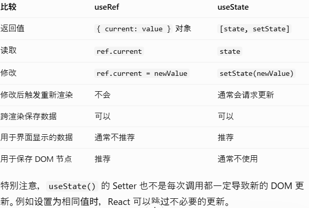
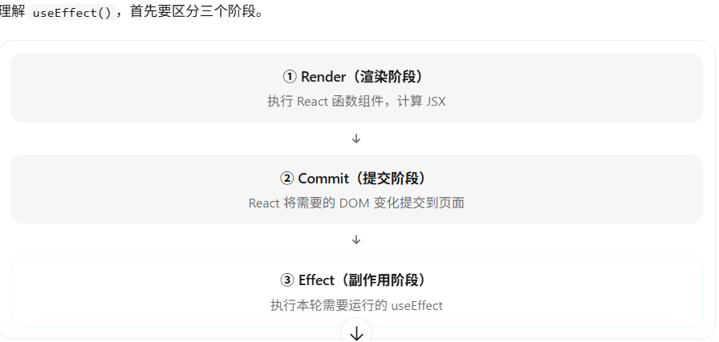

# 使用 ref 引用值
当你希望组件“记住”某些信息，但又不想让这些信息 触发新的渲染 时，你可以使用 ref 。  
与 state 不同的是，ref 是一个普通的 JavaScript 对象，具有可以被读取和修改的 current 属性。
## ref的特点
Ref 对象可以跨多次渲染保留。  
修改 .current 不会主动触发重新渲染。  
Ref 对象通常在同一个组件实例的连续渲染中保持相同的引用。  
## useRef 与 useState 的核心区别

## useRef 最常见的实际用途
场景 1：获取 DOM 元素（最重要）  
```
import { useRef } from 'react'

export default function App() {
    const inputRef = useRef(null)

    function focusInput() {
        inputRef.current?.focus()
    }

    return (
        <div>
            <input
                ref={inputRef}
                placeholder="请输入用户名"
            />

            <button onClick={focusInput}>
                聚焦输入框
            </button>
        </div>
    )
}
```
希望点击按钮后自动聚焦输入框  
场景 2：保存定时器 ID  
```
import { useRef, useEffect } from 'react'

function Timer() {
    const timerRef = useRef(null)

    function startTimer() {
        clearInterval(timerRef.current)

        timerRef.current = setInterval(() => {
            console.log('定时器执行')
        }, 1000)
    }

    function stopTimer() {
        clearInterval(timerRef.current)
        timerRef.current = null
    }

    useEffect(() => {
        return () => {
            clearInterval(timerRef.current)
        }
    }, [])

    return (
        <>
            <button onClick={startTimer}>开始</button>
            <button onClick={stopTimer}>停止</button>
        </>
    )
}
```


## 用途
### 1.操作 DOM
```
function App() {
  const inputRef = useRef(null)

  function handleClick() {
    inputRef.current.focus()
  }

  return (
    <>
      <input ref={inputRef} />

      <button onClick={handleClick}>
        获取焦点
      </button>
    </>
  )
}
```

### 2.ref 可以保存什么？
存定时器：定时器 ID 需要保存，但定时器 ID 改变并不需要让页面重新渲染。  
保存上一次的值

# Effect
有些组件需要与外部系统同步。建立服务器连接或当组件在页面显示时发送分析日志。Effect 允许你在渲染结束后执行一些代码，以便将组件与 React 外部的某个系统相同步。如果所有依赖项都与上一次渲染时相同，React 会跳过本次 Effect。你不能“选择”依赖项，它们是由 Effect 内部的代码所决定的。
**Effect 不是“组件更新后执行的代码”，而是“让 React 状态与外部系统保持同步的代码”。**

## 作用
使用 useEffect 包裹副作用，把它分离到渲染逻辑的计算过程之外。
```
import { useEffect, useRef } from 'react';

function VideoPlayer({ src, isPlaying }) {
  const ref = useRef(null);

  useEffect(() => {
    if (isPlaying) { // isPlaying 在此处使用……
      // ...
    } else {
      // ...
    }
  }, [isPlaying]); // ……所以它必须在此处声明！

  return <video ref={ref} src={src} loop playsInline />;
}
```

### 默认情况下，Effect 会在 每次 渲染后运行。正因如此，以下代码会陷入死循环：
```
const [count, setCount] = useState(0);
useEffect(() => {
  setCount(count + 1);
});
```

## 依赖数组
依赖数组可以包含多个依赖项。只有当你指定的 所有 依赖项的值都与上一次渲染时完全相同，React 才会跳过重新运行该 Effect。  
没有依赖数组和使用空数组 [] 作为依赖数组，行为是不同的：
```
useEffect(() => {
  // 这里的代码会在每次渲染后运行
});

useEffect(() => {
  // 这里的代码只会在组件挂载（首次出现）时运行
}, []);

useEffect(() => {
  // 这里的代码不但会在组件挂载时运行，而且当 a 或 b 的值自上次渲染后发生变化后也会运行
}, [a, b]);
```
```
① Effect 不是组件生命周期。
② Effect 的本质是同步。
③ 依赖数组描述“这个同步依赖什么”。
④ cleanup 是停止同步。
⑤ 每个 Effect 应该代表一个独立的同步过程。
```

## 如何区分“由用户操作触发的事件”和“由状态变化触发的 Effect”。
事件处理函数回答“用户做了什么”，Effect 回答“当页面状态发生变化时，我需要和外部系统同步什么”。

## useEffectEvent 是什么
useEffectEvent 是 React 提供的一个 Hook，用来把 Effect 中的一部分逻辑单独提取出来，让这部分逻辑能够读取最新的 props 和 state，同时不因为这些值变化而触发 Effect 重新执行。
**useEffect 的依赖数组必须包含 Effect 代码中使用到的所有响应式数据**Effect 需要监听某个变化，但里面有些代码只需要读取最新的数据，不应该因此重新执行整个 Effect。

### 为什么需要 useEffectEvent？
假设你正在开发一个聊天室：
roomId：当前聊天室 ID。  
theme：当前页面主题，可能是浅色或深色。  
进入聊天室时建立连接。  
连接成功时，弹出一条使用当前主题的通知。  
```
useEffect(() => {
  const connection = createConnection(roomId);

  connection.on('connected', () => {
    showNotification('连接成功', theme);
  });

  connection.connect();

  return () => connection.disconnect();
}, [roomId, theme]);
```
这里的问题是：切换主题也会导致聊天室断开，再重新连接。但我们实际上只希望 roomId 改变时重新连接。theme 改变只应该影响通知的颜色。  
#### 用 useEffectEvent 改造
```
import { useEffect, useEffectEvent } from 'react';

function ChatRoom({ roomId, theme }) {
  // ① 提取通知逻辑
  const onConnected = useEffectEvent(() => {
    showNotification('连接成功', theme);
  });

  // ② 只在 roomId 变化时重新连接
  useEffect(() => {
    const connection = createConnection(roomId);

    connection.on('connected', () => {
      onConnected();
    });

    connection.connect();

    return () => connection.disconnect();
  }, [roomId]);
}
```

# 移除 Effect 依赖
1. 本来应该由点击事件触发的代码，就不要放进 Effect  
2. 不同的同步任务，拆成不同的 Effect  
3. 使用状态更新函数，避免依赖旧状态  
4. 需要读取最新状态，但不想因它变化而重新同步？考虑 useEffectEvent  
5. 避免每次渲染都创建新的对象或函数依赖  
6. 把真正不变的数据移到组件外部

# React useEffect() 完全详解
useState 负责管理组件状态，useEffect 负责让组件与 React 之外的系统保持同步。

## useEffect() 的基本语法
```
import { useEffect } from 'react'

useEffect(() => {
    // ① setup：执行副作用逻辑

    return () => {
        // ② cleanup：清理副作用，可选
    }
}, [dependencies]) // ③ 依赖数组
```

## 例
```
import { useState, useEffect } from 'react'

export default function Counter() {
    const [count, setCount] = useState(0)

    useEffect(() => {
        console.log('Effect 执行:', count)
    }, [count])

    return (
        <>
            <p>{count}</p>

            <button onClick={() => setCount(c => c + 1)}>
                +1
            </button>
        </>
    )
}
```
首次挂载：`Effect 执行: 0`
点击一次：`Effect 执行: 1`
**useEffect() 不是由 setCount() 直接调用的。它由 React 根据渲染结果及依赖变化，在合适的提交阶段之后执行。**  
  
useEffect 一般在提交后执行，但它与浏览器绘制之间的精确时机还受到交互类型和调度影响，不能简单理解为永远在屏幕绘制之后。

## 依赖数组的三种写法
不传依赖数组  
```
useEffect(() => {
    console.log('effect')
})
```
首次挂载后会执行，之后组件每次成功提交更新时也会执行。  
写法 2：空数组 []  
```
useEffect(() => {
    console.log('effect')
}, [])
```
表示这个 Effect 不依赖组件中的响应式值,初次挂载后执行一次。  
写法 3：指定依赖 [count]  
```
useEffect(() => {
    console.log('effect:', count)
}, [count])
```
初次挂载后执行。之后只有 count 变化时，才需要重新运行这个 Effect。

## cleanup 清理函数为什么先执行？
```
useEffect(() => {
    console.log('effect:', count)

    return () => {
        console.log('cleanup:', count)
    }
}, [count])
```
假设初始值：`count = 0`  
组件首次挂载：`effect: 0`  
接下来点击一次按钮，把 count 改成 1:`cleanup: 0 effect: 1`
再次点击，变成 2：`cleanup: 1 effect: 2`
组件卸载：`cleanup: 2`
**依赖改变时，React 先清理旧 Effect，再执行新 Effect。**
cleanup 的核心不是“组件销毁时执行”，而是“撤销上一次 Effect 建立的副作用”。因此，即使组件没有卸载，只要依赖变化，需要重建 Effect，cleanup 也可能执行。

## 闭包与旧状态：为什么 cleanup 输出旧的 count？
每一次组件渲染，都会创建属于当前渲染的函数和变量环境。当 count = 0 时，Effect 捕获的是这一轮的 count = 0。之后，即使 React 产生了 count = 1 的新渲染，旧 cleanup 的闭包也不会自动变成 count = 1。
### 一个经典错误：setInterval 读取旧状态
```
function Counter() {
    const [count, setCount] = useState(0)

    useEffect(() => {
        const timer = setInterval(() => {
            setCount(count + 1)
        }, 1000)

        return () => clearInterval(timer)
    }, [])

    return <p>{count}</p>
}
```
实际上会停留在：`0 → 1` 因为依赖数组是 []，Effect 初次运行时捕获 count = 0，建立的定时器回调始终使用这个旧值。  
正确写法：  
```
useEffect(() => {
    const timer = setInterval(() => {
        setCount(prev => prev + 1)
    }, 1000)

    return () => clearInterval(timer)
}, [])
```
不会依赖 Effect 闭包中捕获的旧 count，而是根据 React 提供的前一个待计算状态继续更新。这就是 函数式 State 更新能够解决某些旧闭包问题的原因。

# 总结
1.先渲染，后执行 Effect。 Effect 不在组件渲染计算阶段执行。  
2.依赖改变时，先 cleanup，再运行新 Effect。  
3.每一轮 Effect 都有自己的闭包，旧 cleanup 可以读取旧 State。  
4.Effect 要负责清理自己建立的资源，例如定时器、事件监听、WebSocket、异步请求。  
5.能直接计算或通过事件处理解决的事情，通常不需要 useEffect。  