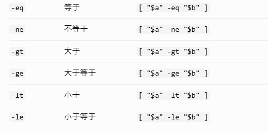

# 为什么日本项目需要shell
日本 IT 项目需要 Shell，主要是因为很多企业系统不仅要开发 Web API，还需要进行批处理（バッチ処理）、定时任务、文件传输、系统运维和自动化部署。

# bash
bash（Bourne Again Shell）是 Linux 中常见的 Shell 命令解释器。
## -n
检查 Bash 语法，不执行脚本

# $
在 Linux Bash 中，$ 主要用于获取变量的值，但它也会出现在特殊变量、命令替换和 Shell 提示符中。

## 实际示例：$1、$2、$#
```
#!/bin/bash

echo "脚本: $0"
echo "第一个参数: ${1:-0}"/没有第一个参数时返回0
echo "第二个参数: ${2:-0}"
echo "参数数量: $#"
```
输出：
```
脚本：test.sh
第一个参数：sales
第二个参数：20261030
参数数量：2
```

## $@
$@ 是 Bash 中的特殊变量，表示传递给 Shell 脚本或函数的所有位置参数。所有参数，并且保留每个参数的边界
```
#!/bin/bash

echo "$@"
```
bash test.sh Tom 20 Tokyo
输出:Tom 20 Tokyo
```

## `$?`：判断命令是否成功

上一条命令的退出状态保存到变量
```
#!/bin/bash

java -jar sales-batch.jar

result=$?

if [ "$result" -eq 0 ]; then
    echo "正常終了"
else
    echo "異常終了"
    exit 1
fi
```

# $(command)
命令替换（Command Substitution）。先执行括号里的命令，再把命令的标准输出（stdout）替换到当前位置。
```
today=$(date +%Y%m%d)

echo "$today"
```

# export
export 是 Bash 中的内置命令，用于将 Shell 变量导出为环境变量，让当前 Shell 启动的子进程也能读取它，例如：`export APP_ENV=production`

# 条件判断

[[ -f "$f" ]]：判断是否为普通文件  
[[ -s "$f" ]]：判断文件是否非空  
## 多分支判断 elif
```
#!/bin/bash

result=2

if [ "$result" -eq 0 ]; then
    echo "正常終了"
elif [ "$result" -eq 1 ]; then
    echo "入力エラー"
elif [ "$result" -eq 2 ]; then
    echo "DBエラー"
else
    echo "不明なエラー"
fi
```
## case：多条件分支
```
#!/bin/bash

ACTION="$1"

case "$ACTION" in
    start)
        echo "启动批处理"
        ;;
    stop)
        echo "停止批处理"
        ;;
    status)
        echo "检查状态"
        ;;
    *)
        echo "不支持的操作：$ACTION"
        exit 1
        ;;
esac
```

## 循环 for
```
#!/bin/bash

for name in Tom Jack Alice
do
    echo "Hello $name"
done
```

## 循环 while
```
#!/bin/bash

count=1

while [[ "$count" -le 5 ]]; do
    echo "第 $count 次执行"
    count=$((count + 1))
done
```
### while IFS= read -r line; do ...; done < file
这是一种在 Shell 脚本中逐行读取文件内容的标准写法。
```
#!/bin/bash

while IFS= read -r line; do
    echo "读取到：$line"
done < sales.csv
```

## 函数定义 name() { ...; }
```
#!/bin/bash

hello() {
    echo "Hello"
    echo "World"
}

hello

echo "脚本结束"
```

# Bash 三个标准流与重定向方向
在 Linux Shell 中，每个进程通常有三个标准流：

## 1. <：文件输入到命令
`wc -l < input.txt`
## 2. <<：把多行文本输入命令
```
cat <<EOF
Hello
World
EOF
```
## 3. >：覆盖标准输出
`echo "Hello" > output.txt`方向`echo ──stdout──> output.txt`
## 4. >>：追加标准输出
方向与 > 一样，区别是不会清空原有内容，而是追加到末尾。
## 5. 2>：重定向标准错误
`cat missing.txt 2> error.log`方向`cat ──stderr(2)──> error.log`
## 6. 2>&1：把错误输出合并到 stdout 的目标
`java -jar app.jar > app.log 2>&1`
`> app.log`：stdout 指向 app.log。2>&1：stderr 也指向当前 stdout 的目标。  
`>` 因此正常输出和错误输出都会写入 app.log。
## 7. |：管道
`cat app.log | grep ERROR`管道默认只传递 stdout，不会自动传递 stderr。
