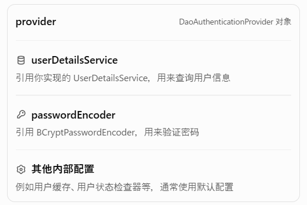

# 什么是 JWT?
JWT （JSON Web Token） 是目前最流行的跨域认证解决方案，是一种基于 Token 的认证授权机制。

# JWT 由哪些部分组成？
Header（头部） : 描述 JWT 的元数据，定义了生成签名的算法以及 Token 的类型。Header 被 Base64Url 编码后成为 JWT 的第一部分。  
Payload（载荷） : 用来存放实际需要传递的数据，包含声明（Claims），如sub（subject，主题）、jti（JWT ID）。Payload 被 Base64Url 编码后成为 JWT 的第二部分。  
Signature（签名）：服务器通过 Payload、Header 和一个密钥(Secret)使用 Header 里面指定的签名算法（默认是 HMAC SHA256）生成。生成的签名会成为 JWT 的第三部分。  
## Header
typ（Type）：令牌类型，也就是 JWT。  
alg（Algorithm）：签名算法，比如 HS256。  
## Payload
Registered Claims（注册声明）：预定义的一些声明，建议使用，但不是强制性的。  
Public Claims（公有声明）：JWT 签发方可以自定义的声明，但是为了避免冲突，应该在 IANA JSON Web Token Registry 中定义它们。  
Private Claims（私有声明）：JWT 签发方因为项目需要而自定义的声明，更符合实际项目场景使用。  
iss（issuer）：JWT 签发方。  
iat（issued at time）：JWT 签发时间。  
sub（subject）：JWT 主题。  
aud（audience）：JWT 接收方。  
exp（expiration time）：JWT 的过期时间。  
nbf（not before time）：JWT 生效时间，早于该定义的时间的 JWT 不能被接受处理。  
jti（JWT ID）：JWT 唯一标识。  
## Signature
Signature 部分是对前两部分的签名，作用是防止 JWT（主要是 payload） 被篡改。

## 生成JWT完整流程
1.用户发送post请求，SecurityFilterChain放行登录接口
2.UserController接受Loginrequest进入authService登录业务层调用login方法
3.进入login方法，首先执行Authentication authentication = authenticate(account, password);验证账号和密码
4.在authentication中首先调用UsernamePasswordAuthenticationToken构造方法
这个对象主要包含：
```
principal     = "husidgfi"  // 账号
credentials   = "123456"    // 密码
authorities   = []          // 暂无权限
authenticated = false       // 尚未认证
```
5.交给认证管理器AuthenticationManager并使用使用 DaoAuthenticationProvider 来验证用户的账号和密码同时调用loadUserByUsername(),返回一个provide对象

6.创建一个认证管理器 ProviderManager，并把你之前配置好的 DaoAuthenticationProvider 认证器交给它管理。
```
AuthServiceImpl
    │
    └── authenticationManager.authenticate(authToken)//创建authToken把账号密码封装成一个类对象
            │
            ▼
        ProviderManager.authenticate()//认证管理器选择哪个认证器处理当前请求
            │
            ▼
        DaoAuthenticationProvider//它是 Spring Security 提供的账号密码认证器并配置userDetailsService去哪里查询用户passwordEncoder如何验证密码
            │
            ├── retrieveUser()//负责获取用户信息的方法。
            │       │
            │       └── loadUserByUsername()//自己实现的在数据库中寻找用户的方法
            │               │
            │               └── MySQL 查询用户和密码哈希
            │
            └── additionalAuthenticationChecks()//验证密码
                    │
                    └── passwordEncoder.matches()//BCrypt 会利用已存储哈希中的盐值和成本参数，对输入的密码进行验证。
                            │
                            ├── true  → 认证成功
                            └── false → 抛出 BadCredentialsException
```
7.最终返回的是一个 Authentication 对象，里面保存了认证成功的用户身份信息、权限以及认证状态。
8.设置jwt时间，设置token的存活时间
9.创建 JWT 的 Payload（载荷）内容，设置当前登录用户是谁、JWT 由谁签发、给谁使用，以及什么时候生成、什么时候过期。
10.把之前创建的 JWT Claims 包装成编码参数。使用 JWT 编码器生成并签名 JWT根据payload来生成的。
11.把生成好的 JWT、认证类型和有效期封装起来，然后返回给调用者。