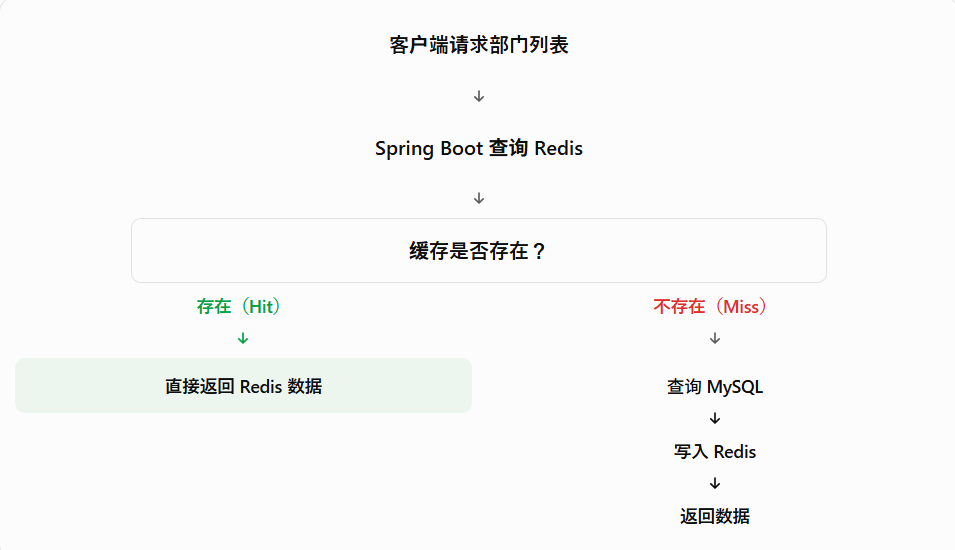

# Redis 是什么

Redis 是一个基于内存的高性能键值数据库（Key-Value Database），经常被用来做缓存（Cache）、Session 存储、计数器等。

# 缓存何时使用：Cache Aside 与 Spring Cache
在 Spring Boot 中，Redis 经常被用作缓存，但不是所有数据都适合缓存。
## 什么时候应该使用缓存？
读取频繁：例如每次进入注册页面都需要查询部门列表。  
修改较少：部门名称、部门代码不会经常变化。  
允许短时间的数据延迟：例如部门名称修改后，缓存可能短暂保留旧数据。

## Cache Aside（旁路缓存）
应用程序先查询 Redis，缓存不存在时再查询 MySQL，并将结果保存到 Redis。

## Spring Cache
Spring Cache 是 Spring 提供的缓存抽象框架。