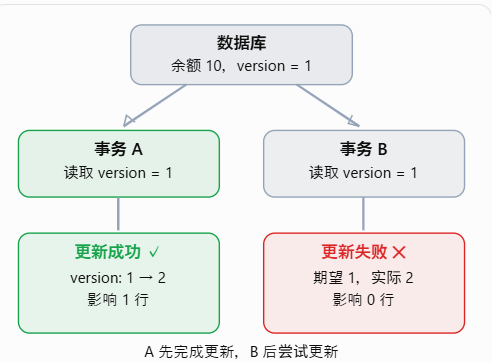
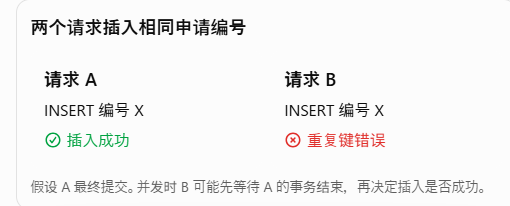
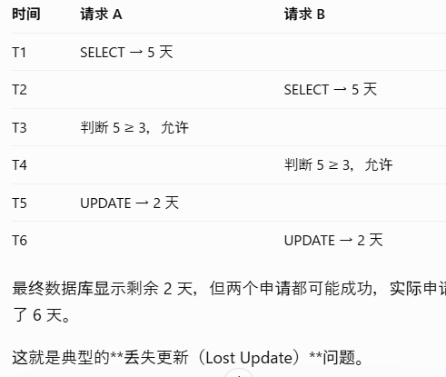
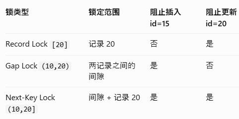
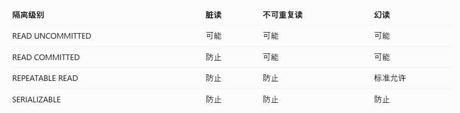

# 事务的 ACID 特点
A	Atomicity	原子性	要么全部成功，要么全部失败  
C	Consistency	一致性	事务前后，数据必须满足约束和业务规则  
I	Isolation	隔离性	并发事务之间需要适当隔离  
D	Durability	持久性	提交成功的数据不会因系统崩溃而丢失  

# 事务自调用失效
Spring 的 @Transactional 通常通过 AOP 代理对象实现，而同类内部使用 this 调用方法时，会绕过代理对象。
```
@Service
public class LeaveService {

    public void applyLeave() {
        saveApplication();//同类调用会绕过代理对象
    }

    @Transactional
    public void saveApplication() {
        leaveMapper.insert();
        userMapper.updateRemainingDays();
    }
}
```
## 解决办法
把 @Transactional 放在外部调用的方法上
```
@Service
public class LeaveService {

    @Transactional
    public void applyLeave() {
        saveApplication();
    }

    public void saveApplication() {
        leaveMapper.insert();
        userMapper.updateRemainingDays();
    }
}
```
把事务方法拆到另一个 Service
```
@Service
public class LeaveTransactionService {

    @Transactional
    public void saveApplication() {
        leaveMapper.insert();
        userMapper.updateRemainingDays();
    }
}
```

## 悲观锁
通过让其他事务等待，避免多个事务同时修改同一条数据。
**注意普通非锁定SELECT通常仍能读MVCC快照。**  
即使事务 A 使用 SELECT ... FOR UPDATE 锁住了一条记录，事务 B 通常仍然可以使用普通 SELECT 读取这条记录。

## 乐观锁
不提前锁住数据，修改时检查数据有没有被别人改过。如果被改过，就让本次更新失败。


### 防止并发执行时出现重复行
添加唯一约束


### 在一条 SQL 中判断并修改
把「判断是否满足条件」和「修改数据」放在同一条 SQL 中执行。
#### 为什么先 SELECT 再 UPDATE 有风险？


### 提交时验证version
不提前锁住数据，修改时检查数据有没有被别人改过。如果被改过，就让本次更新失败。

### 先锁定最新记录再处理
通过让其他事务等待，避免多个事务同时修改同一条数据。

## 共享锁（S Lock，Shared Lock）
允许多个事务同时读取同一条数据，但在共享锁释放之前，不允许其他事务修改这条数据。大家可以一起读，但暂时谁也不能改。
### 为什么需要共享锁？
假设事务 A 正在检查某条休假申请记录，并要求在事务结束之前，这条记录不能被其他事务修改。

## 记录锁（Record Lock）
Record Lock 锁住的是一条已存在的索引记录，而不是整个表，也不是相邻记录之间的间隙。

## Gap Lock（间隙锁）
Gap Lock（间隙锁）是 MySQL InnoDB 用来锁住两条索引记录之间的空隙，防止其他事务在这个空隙中插入新记录的一种锁。

## Next-Key Lock（临键锁）
也就是说，它不仅锁住一条已经存在的索引记录，还锁住这条记录前面的间隙。

### 三种锁的区别


## MVCC 是什么
MVCC（Multi-Version Concurrency Control，多版本并发控制） 是 MySQL InnoDB 用来管理并发读取的一种机制。一条数据可以存在多个历史版本，不同事务根据自己的可见性规则读取合适的版本，而不一定要等待其他事务释放锁。

## 4 种事务隔离级别

