# Spring框架
Spring框架的核心功能有两个:
Spring的核心就是能管理一组Bean，并能自动配置依赖关系的IoC容器。IoC 容器（Inversion of Control Container，控制反转容器）就是 Spring 中负责创建、管理和组装 Java 对象的容器。以前对象由程序员自己 new，现在由 Spring 的 IoC 容器帮你创建和管理。Spring的IoC容器分为两类：BeanFactory和ApplicationContext，前者总是延迟创建Bean，而后者则在启动时初始化所有Bean。  
Spring容器管理容器中Bean之间的依赖关系，Spring使用一种被称为"依赖注入"的方式来管理Bean之间的依赖关系。
## 依赖注入
DI（依赖注入）： Spring 把创建好的 Service 对象通过构造函数传给 Controller。  

# IoC容器
## 实现ResourceResolver
在编写IoC容器之前，我们首先要实现@ComponentScan，即解决“在指定包下扫描所有Class”的问题。
## 实现PropertyResolver
Spring的注入分为@Autowired和@Value两种。对于@Autowired，涉及到Bean的依赖，而对于@Value，则仅仅是将对应的配置注入，不涉及Bean的依赖，相对比较简单。  
@Autowired：注入 Spring 容器管理的 Bean（对象）。  
@Value：注入配置值，例如端口、名称、路径等。  
### @Autowired：注入对象
项目结构:  
```
spring-ioc-demo
├── src/main/java
│   └── com.example.spring_ioc_demo
│       ├── SpringIocDemoApplication.java
│       ├── controller
│       │   └── HelloController.java
│       └── service
│           └── HelloService.java
├── src/main/resources
│   └── application.properties
└── pom.xml
```
#### IoC（控制反转）
把对象创建和管理的控制权交给 Spring 容器。
没有 Spring 时：HelloService service = new HelloService();  
使用 Spring 后，Spring 容器可以自动创建和管理对象。
#### Bean
Bean 是由 Spring IoC 容器管理的 Java 对象。  
例如：
```
@Service
public class HelloService {
}
```
在组件扫描范围内，Spring 会发现该类，并注册一个对应的 Bean。
#### DI（依赖注入）
把某个对象所需要的依赖，从外部提供给它。
```
@RestController
public class HelloController {

    @Autowired
    private HelloService helloService;//Spring 找到对应的 HelloService Bean，并注入到 Controller 中。

    @GetMapping("/hello")
    public String hello() {
        return helloService.sayHello();
    }
}
```
**当一个 Spring Bean 类只有一个构造方法时，Spring 会自动通过这个构造方法注入需要的对象，即使没有写@Autowired。**
```
@RestController
public class HelloController {

    private final HelloService helloService;

    public HelloController(HelloService helloService) {
        this.helloService = helloService;
    }

    @GetMapping("/hello")
    public String hello() {
        return helloService.sayHello();
    }
}
```
Spring 启动时：
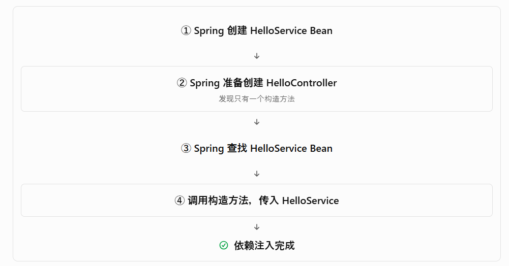
##### 如果有多个构造方法呢？
```
@RestController
public class HelloController {

    private HelloService helloService;

    // 构造方法一：无参
    public HelloController() {
        System.out.println("执行无参构造方法");
    }

    // 构造方法二：有参
    @Autowired
    public HelloController(HelloService helloService) {
        System.out.println("执行有参构造方法");
        this.helloService = helloService;
    }

    @GetMapping("/hello")
    public String hello() {
        return helloService.sayHello();
    }
}
```
@Autowired 能区分多个构造方法，是因为 Spring 在创建 Bean 时，会检查构造方法上的注解，并根据注解决定使用哪个构造方法。

### @Value
注入配置值，例如字符串、数字、布尔值等。
```
@RestController
public class HelloController {

    private HelloService helloService;
    private final String appName;
    
    public HelloController(HelloService helloService, @Value("${app.name}") String appName) {
        this.helloService = helloService;
        this.appName = appName;
    }
    
    @GetMapping("/hello")
    public String hello() {
        return appName+ ": " +helloService.sayHello();
    }
}
```
@Value 是怎么工作的？  
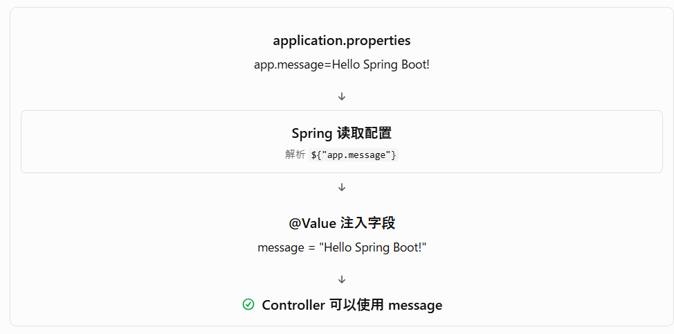

## 创建BeanDefinition
在IoC容器中，每个Bean都有一个唯一的名字标识。Spring还允许为一个Bean定义多个名字，这里我们简化一下，一个Bean只允许一个名字，因此，很容易想到用一个Map<String, Object>保存所有的Bean。
### Spring IoC 容器是怎么保存和管理 Bean 的。
给每个 Bean 一个名字，然后通过这个名字找到对应的 Java 对象。使用 Map 保存 Java 对象。
### Bean的声明类型
对于@Component定义的Bean，它的声明类型就是其Class本身。然而，对于用@Bean工厂方法创建的Bean，它的声明类型与实际类型不一定是同一类型。

## 创建Bean实例
### Spring支持的4种依赖注入模式
#### 构造器注入
```
@RestController
public class HelloController {

    private final HelloService helloService;

    public HelloController(HelloService helloService) {
        this.helloService = helloService;
    }
}
```
Spring 在创建 HelloController 时，会把 HelloService Bean 作为构造方法参数传进去。
#### Setter 注入
```
@RestController
public class HelloController {

    private HelloService helloService;

    @Autowired
    public void setHelloService(HelloService helloService) {
        this.helloService = helloService;
    }
}
```
Spring 先创建 Controller，再调用`setHelloService(helloService);`通过 Setter 方法注入依赖。
#### 字段注入
```
@RestController
public class HelloController {

    @Autowired
    private HelloService helloService;
}
```
Spring 直接向字段注入 Bean，不需要自己写构造方法或 Setter 方法。这种写法简单，但是依赖不够明确，也不方便单元测试，因此实际开发一般不优先推荐。
#### 工厂方法注入@Bean
@Bean 是由程序员编写一个方法，通过这个方法告诉 Spring 如何创建对象。  
HelloService.java虽然 HelloService 没有 @Service，但 Spring 仍然可以注入，因为我们已经通过 @Bean 注册了它。   
```
package com.example.spring_ioc_demo.service;

public class HelloService {

    public String sayHello() {
        return "Hello Spring @Bean!";
    }
}
```
AppConfig.java
```
package com.example.spring_ioc_demo.config;

import org.springframework.context.annotation.Bean;
import org.springframework.context.annotation.Configuration;

import com.example.spring_ioc_demo.service.HelloService;

@Configuration//告诉 Spring：这是一个配置类，里面定义了 Bean 的创建方式。
public class AppConfig {

    @Bean//告诉 Spring：调用这个方法获取一个 Bean。
    public HelloService helloService() {

        System.out.println("创建 HelloService Bean");

        return new HelloService();
    }
}
```
HelloController.java
```
package com.example.spring_ioc_demo.controller;

import org.springframework.web.bind.annotation.GetMapping;
import org.springframework.web.bind.annotation.RestController;

import com.example.spring_ioc_demo.service.HelloService;

@RestController
public class HelloController {

    private final HelloService helloService;

    public HelloController(HelloService helloService) {
        this.helloService = helloService;
    }

    @GetMapping("/hello")
    public String hello() {
        return helloService.sayHello();
    }
}
```
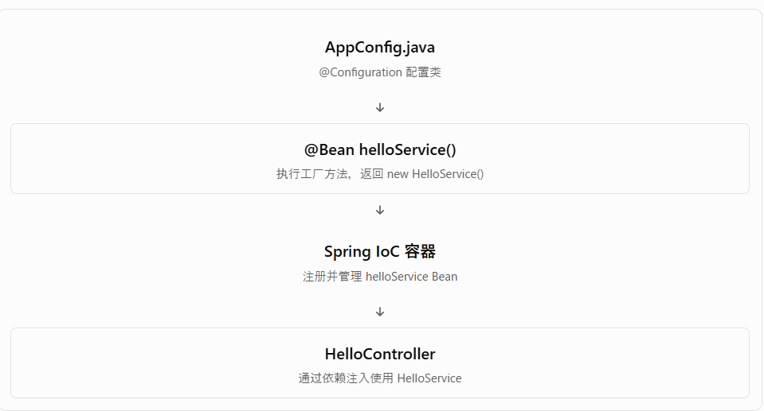

# Web MVC
Web MVC 是 Spring 用来开发 Web 应用和 REST API 的框架。DispatcherServlet 负责接收请求，Controller 负责处理请求，ViewResolver 负责寻找页面，RestController 负责返回数据，拦截器和异常处理器负责公共处理逻辑。
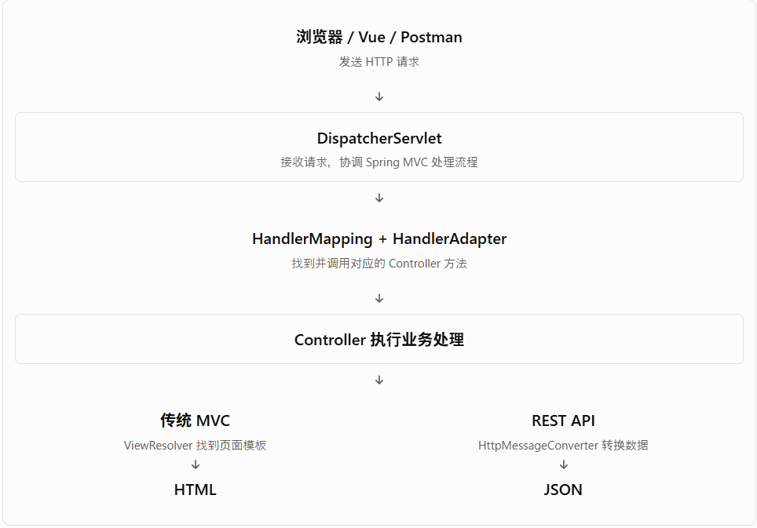
## 启动IoC容器
Java Web应用一般遵循Servlet标准，这个标准定义了应用程序可以按接口编写哪些组件：Servlet、Filter和Listener，也规定了一个服务器（如Tomcat、Jetty、JBoss等）应该提供什么样的服务，按什么顺序加载应用程序的组件，最后才能跑起来处理来自用户的HTTP请求。
### Servlet规范定义的组件有3类
Servlet：处理HTTP请求，然后输出响应；  
Filter：对HTTP请求进行过滤，可以有多个Filter形成过滤器链，实现权限检查、限流、缓存等逻辑；  
Listener：用来监听Web应用程序产生的事件，包括启动、停止、Session有修改等。  
### 整个MVC的处理都是在DispatcherServlet内部完成的。
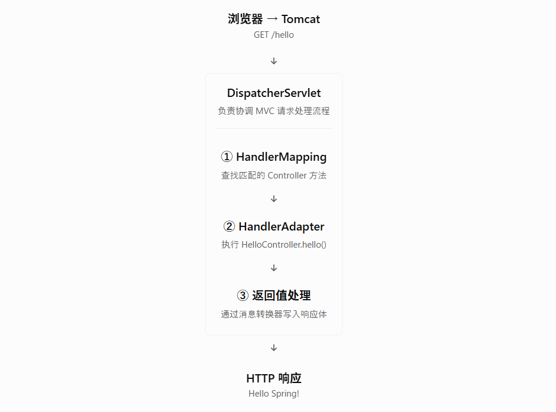
DispatcherServlet 是 Spring MVC 的总指挥，不是所有工作的实际执行者。

# 定制Bean
对于Spring容器来说，当我们把一个Bean标记为@Component后，它就会自动为我们创建一个单例（Singleton），即容器初始化时创建Bean，容器关闭前销毁Bean。在容器运行期间，我们调用getBean(Class)获取到的Bean总是同一个实例。
**Spring IoC 容器默认只为一个 Bean 定义创建一个实例。之后无论获取多少次，得到的通常都是同一个对象。**
## 什么是 Singleton（单例）
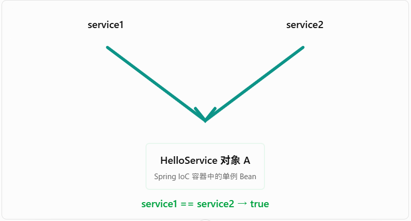
## 容器初始化时创建 Bean，容器关闭前销毁 Bean。
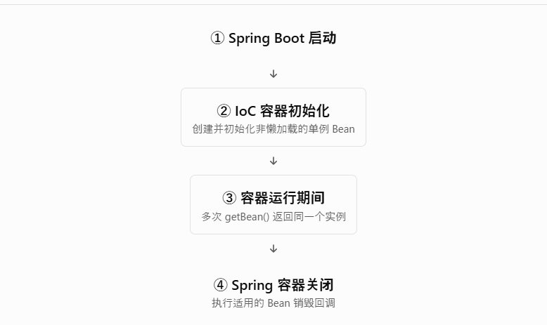

# 使用AOP
AOP是Aspect Oriented Programming，即面向切面编程。
## OOP 和 AOP 有什么区别
OOP（面向对象编程）：把程序组织成多个对象，通过对象之间的调用实现功能。  
AOP（面向切面编程）：把分散在多个业务方法中的公共功能抽取出来，统一处理。  
## AOP核心的思想
让代理对象替我们执行一些额外操作，再调用原始业务方法。
### @Before@After@Around
@Before：这种拦截器先执行拦截代码，再执行目标代码。如果拦截器抛异常，那么目标代码就不执行了。  
@After：这种拦截器先执行目标代码，再执行拦截器代码。无论目标代码是否抛异常，拦截器代码都会执行。  
@AfterReturning：和@After不同的是，只有当目标代码正常返回时，才执行拦截器代码。  
@AfterThrowing：和@After不同的是，只有当目标代码抛出了异常时，才执行拦截器代码。  
@Around：能完全控制目标代码是否执行，并可以在执行前后、抛异常后执行任意拦截代码，可以说是包含了上面所有功能。  
```
@Aspect
@Component
public class LoggingAspect {

    @Around(
        "execution(* com.example.spring_ioc_demo.service.UserService.*(..))"
    )
    public Object around(ProceedingJoinPoint joinPoint)
            throws Throwable {

        System.out.println("记录日志：开始");

        Object result = joinPoint.proceed();

        System.out.println("记录日志：结束");

        return result;
    }
}
```
### Spring AOP 的切入点（Pointcut）匹配规则
```
@Around("execution(public * update*(..))")
public Object doLogging(ProceedingJoinPoint pjp) throws Throwable {

    // 切换到主数据库
    String old = setCurrentDataSource("master");

    // 执行业务方法
    Object retVal = pjp.proceed();

    // 恢复原来的数据源
    restoreCurrentDataSource(old);

    return retVal;
}
```
为什么说“非精准打击，误伤面更大”？**因为 AOP 只检查：`update*`**它不知道方法内部真正执行的是什么业务逻辑。例如：
```
public void updateStatisticsCache() {
    // 只更新内存缓存
}
```
也匹配成功！这个方法可能根本没有数据库操作，却仍然执行了数据库切换逻辑。
#### 解决办法

# 三层架构和mvc的区别
三层架构关注业务代码如何分工，MVC 关注用户请求、数据和界面如何组织。
## 什么是三层架构？
Controller（表现层），Service（业务逻辑层），Mapper / DAO（数据访问层）
## 什么是 MVC？（Model，View，Controller）
请求、数据和界面的分离
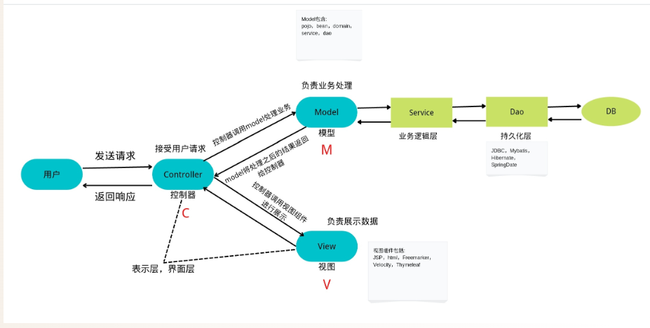
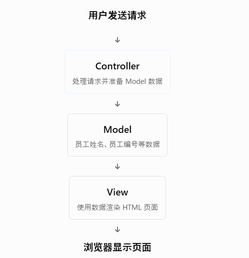

# 启动类文件
```
package com.example.spring_ioc_demo;

import org.springframework.boot.SpringApplication;
import org.springframework.boot.autoconfigure.SpringBootApplication;

@SpringBootApplication//告诉 Spring Boot，这个类是应用程序的启动配置类。
public class SpringIocDemoApplication {

    public static void main(String[] args) {

        SpringApplication.run(//负责启动 Spring Boot 应用，创建并初始化 Spring IoC 容器。
            SpringIocDemoApplication.class,
            args
        );
    }
}
```
@SpringBootApplication 是一个组合注解。它相当于组合了三个重要注解：@SpringBootConfiguration@EnableAutoConfiguration@ComponentScan
## 1. @SpringBootConfiguration：声明配置类
表示这个类可以作为 Spring Boot 的配置类，用来定义 Bean 等配置。
## 2. @EnableAutoConfiguration：自动配置
它会根据项目中的依赖、配置属性和已有 Bean 等条件，决定是否自动配置相关组件。
## 3. @ComponentScan：扫描 Bean
负责扫描指定包范围内的 Spring 组件，例如@Component@Service
## SpringApplication.run() 做了什么
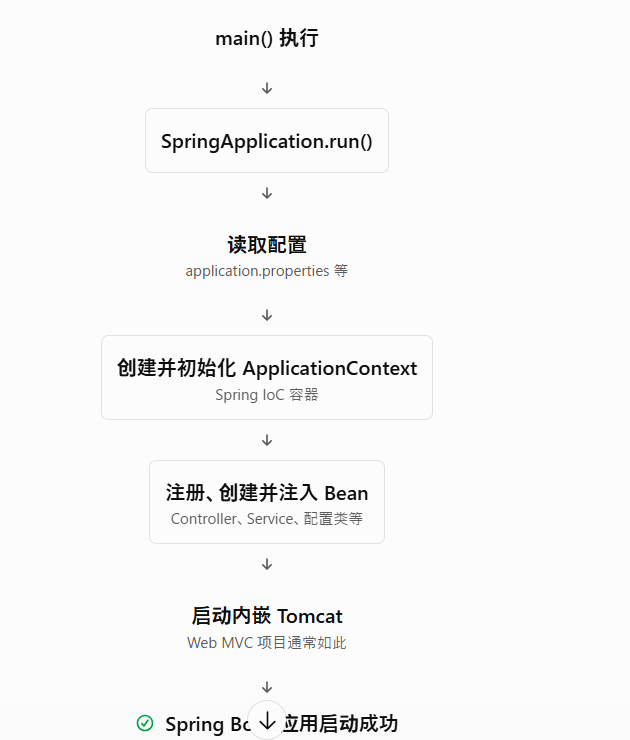

# @Controller、@ResponseBody 和 @RestController
```
@Controller//告诉 Spring MVC，这个类是处理 HTTP 请求的控制器。
public class PageController {

    // 返回 HTML 页面
    @GetMapping("/test/page")
    public String page() {
        return "forward:/hello.html";
    }

    // 直接返回字符串
    @GetMapping("/test/text")
    @ResponseBody//告诉 Spring MVC，方法的返回值应该直接作为 HTTP 响应内容，而不是视图名称。
    public String text() {
        return "Hello Spring MVC!";
    }
}
```
第一个：
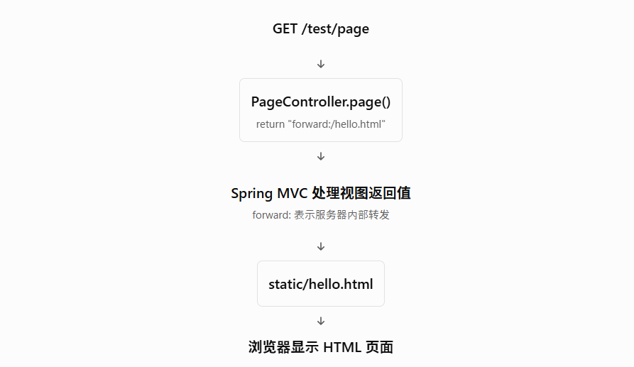
第二个：
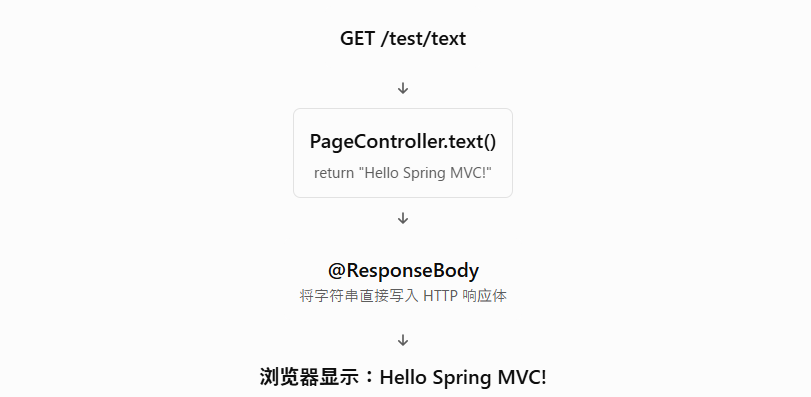
## @RestController = @Controller + @ResponseBody（类级别）

### @PathVariable 和 @RequestParam 的区别
```
@RestController
public class UserController {

    @GetMapping("/users/{userId}")
    public String getUser(@PathVariable(userId) Long id) {//表示从 URL 中提取名为 id 的变量，并转换成 Long 类型。http://localhost:8082/users/10
        return "用户ID：" + id;
    }
    

    @GetMapping("/users")
    public String getUser(@RequestParam String name) {//从 URL 查询字符串中取值，例如 /employees?id=10。

        return "用户名：" + name;
    }
}
```

# 同一接口有多个bean时会出现什么问题
```
package com.example.spring_ioc_demo.controller;

import com.example.spring_ioc_demo.service.MessageService;
import org.springframework.web.bind.annotation.GetMapping;
import org.springframework.web.bind.annotation.RestController;

@RestController
public class MessageController {

    private final MessageService messageService;

    public MessageController(MessageService messageService) {
        this.messageService = messageService;
    }

    @GetMapping("/message")
    public String send() {
        return messageService.send();
    }
}
```
```
Description:

Parameter 0 of constructor in com.example.spring_ioc_demo.controller.MessageController required a single bean, but 2 were found
```
构造器需要一个 MessageService 类型的 Bean。Spring 在 IoC 容器中找到了两个符合条件的 Bean

## 如何解决
### 一、方法一：使用 @Primary
修改 EmailService.java,SmsService.java 不需要修改。
@Primary当有多个 Bean 时，默认优先选择。
```
package com.example.spring_ioc_demo.service;

import org.springframework.context.annotation.Primary;
import org.springframework.stereotype.Service;

@Service
@Primary//当有多个 MessageService Bean 时，默认优先选择 EmailService。
public class EmailService implements MessageService {

    @Override
    public String send() {
        return "发送邮件成功";
    }
}
```
### 二、方法二：使用 @Qualifier
如果你希望明确使用 SmsService，可以在构造器参数上添加 @Qualifier。
```
@RestController
public class MessageController {

    private final MessageService messageService;

    public MessageController(
            @Qualifier("smsService") MessageService messageService) {//告诉 Spring，这里需要注入名为 smsService 的 Bean。

        this.messageService = messageService;
    }
    @GetMapping("/message")
    public String send() {
        return messageService.send();
    }
}
```

# DTO（数据传输对象）以及请求和响应的数据设计
## EmployeeCreateRequest.java是干什么用的
接收前端在新增员工时提交的数据，并将这些数据封装成一个 Java 对象。
## dto的作用
DTO（Data Transfer Object，数据传输对象）就是专门用来传递数据的 Java 对象。
## DTO 在程序中怎么工作？
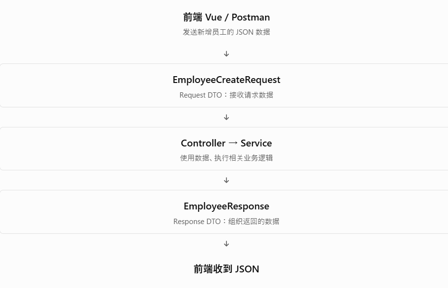
### @RequestMapping
@RequestMapping 是 Spring MVC 中的一个注解，用来建立 HTTP 请求地址（URL）与 Controller 之间的映射关系。当用户访问某个 URL 时，应该由哪个 Controller 或方法处理请求。
### @RequestMapping 和 @GetMapping，@PostMapping 有什么区别？
`@GetMapping("/hello")`=
```
@RequestMapping(
    value = "/hello",
    method = RequestMethod.GET
)
```
`@PostMapping("/employees")`=
```
@RequestMapping(
    value = "/employees",
    method = RequestMethod.POST
)
```
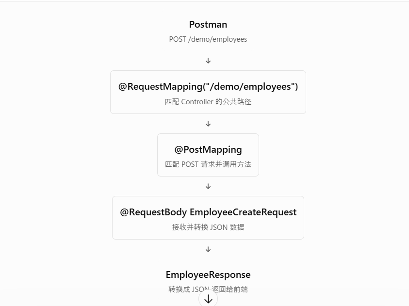
**@RequestMapping 负责 URL 映射，类上定义公共路径，方法上定义具体路径和请求条件。**

#### Content-Type和Accept分别表达什么
Content-Type 和 Accept 都是 HTTP 请求头（Request Headers），在 Spring Boot API 开发中非常常见。Content-Type：我发送给你的数据是什么格式。Accept：我希望你返回给我的数据是什么格式。

### Jackson 是干什么的？
Jackson 是一个 Java JSON 处理库，主要负责两种转换

重点是四个注解：
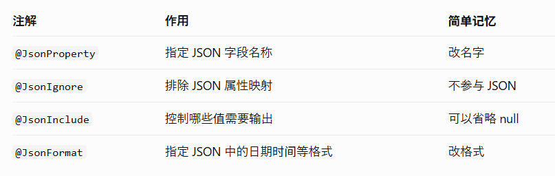

# 成功与失败怎样返回
Spring Boot 不仅要返回数据，还要正确告诉前端请求是成功了，还是失败了，以及为什么失败。
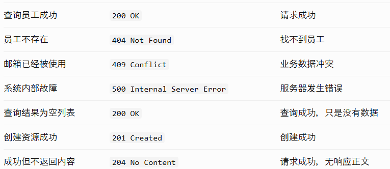
## ResponseEntity 是什么？
可以理解为一个完整的 HTTP 响应对象，它可以控制：状态码，响应头Content-Type，响应正文(字符串或 JSON)
```
@RestController
@RequestMapping("/demo/response")
public class ResponseEntityController {

    // 1. 查询员工
    @GetMapping("/{id}")
    public ResponseEntity<String> getEmployee(
            @PathVariable Long id) {

        if (id.equals(1L)) {
            return ResponseEntity.ok("员工：Tom");
        }

        return ResponseEntity
                .status(HttpStatus.NOT_FOUND)
                .body("员工不存在");
    }

    // 2. 新增员工
    @PostMapping
    public ResponseEntity<String> createEmployee() {

        return ResponseEntity
                .status(HttpStatus.CREATED)
                .body("员工创建成功");
    }
}
```
## ApiResponse 是什么
ApiResponse 是我们在 Spring Boot 项目中自己定义的统一响应类，用来规范后端返回给前端的 JSON 格式。
```
package com.example.spring_ioc_demo.dto.response;

public class ApiResponse<T> {

    private final boolean success;
    private final String message;
    private final T data;

    public ApiResponse(boolean success, String message, T data) {
        this.success = success;
        this.message = message;
        this.data = data;
    }

    // 成功响应
    public static <T> ApiResponse<T> success(T data) {
        return new ApiResponse<>(true, "OK", data);
    }

    // 失败响应
    public static <T> ApiResponse<T> failure(String message) {
        return new ApiResponse<>(false, message, null);
    }

    public boolean isSuccess() {
        return success;
    }

    public String getMessage() {
        return message;
    }

    public T getData() {
        return data;
    }
}
```
## ApiResponse 和 ResponseEntity 的区别
ResponseEntity 负责控制 HTTP 响应，ApiResponse 负责统一返回的数据格式。
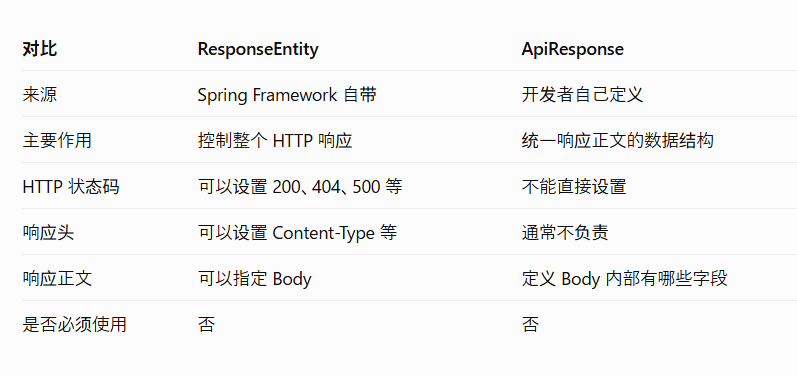
### 先看 ResponseEntity
当访问 /employee/99 时：
```
HTTP/1.1 404 Not Found
Content-Type: text/plain
```
这里 ResponseEntity 控制两个东西：  
- .status(404)：设置 HTTP 状态码。  
- .body("员工不存在")：设置响应正文。  
- 但它没有要求正文必须遵循某种统一的数据格式。
### 再看 ApiResponse
ApiResponse 本身并不知道 HTTP 状态码应该是 200 还是 404。在没有其他状态码设置的情况下，Spring MVC 通常仍然返回 HTTP 200 OK，尽管 JSON 里面的 success 是 false。
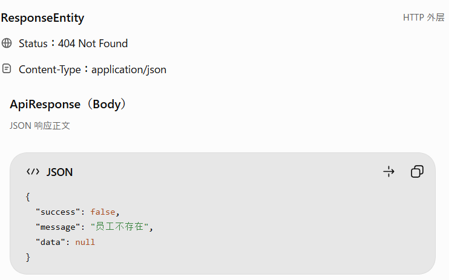
```
ResponseEntity
    │
    ├── HTTP 状态码
    ├── HTTP 响应头
    │
    └── Body：ApiResponse
                  │
                  ├── success
                  ├── message
                  └── data
```

## A06. Header、Cookie 与文件上传
除了 URL 参数和 JSON 请求体，Spring Boot 还可以从 HTTP 请求头、Cookie 和上传文件中获取数据。
### @RequestHeader：获取 HTTP 请求头
```
Content-Type: application/json
Accept: application/json
```
这些都是 HTTP Header。
现在 Spring Boot 可以使用 @RequestHeader 读取它们。
### @CookieValue：获取 Cookie
Cookie 是客户端保存并在符合条件的请求中发送给服务器的数据。例如你访问某个网站时，网站可能通过 Cookie 保存语言偏好。
### @RequestPart：接收文件上传
一个请求既要发送 JSON 数据，又要上传文件,就可以使用：`Content-Type: multipart/form-data`
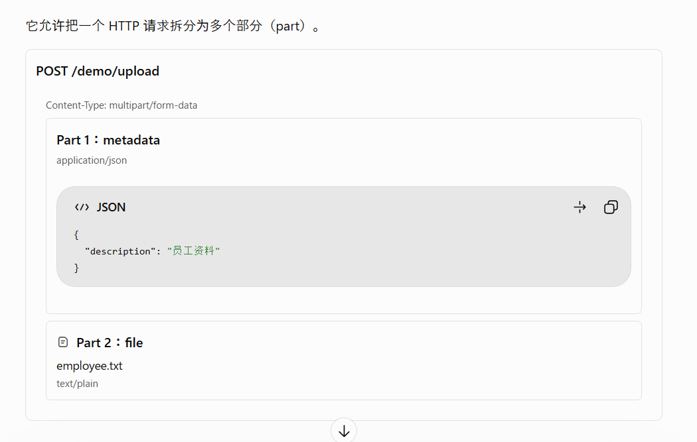

## GlobalExceptionHandler.java是什么
GlobalExceptionHandler.java 是 Spring Boot 项目中常见的全局异常处理类。
当 Controller 或 Service 处理请求时发生异常，统一捕获这些异常，并返回规范的 HTTP 错误响应。

### @RestControllerAdvice
这个类负责为多个 Controller 提供统一的异常处理，并直接返回响应数据。结合了 @ControllerAdvice 和 @ResponseBody 的功能。声明全局 REST 异常处理组件

### @ExceptionHandler
@ExceptionHandler 的作用是：当 Service 抛出异常时，让 Spring MVC 找到对应的异常处理方法，把 Java 异常转换成 HTTP 错误响应，返回给前端。

### GlobalExceptionHandler.java怎么实现全局错误管理的
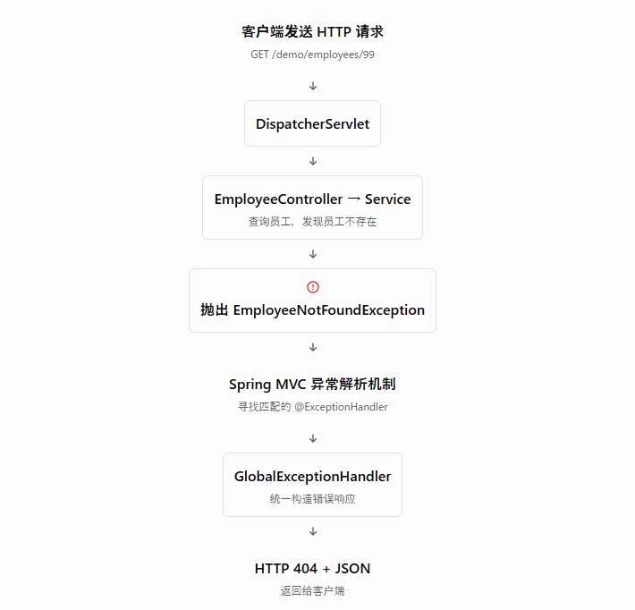
Controller 抛异常，Spring MVC 负责分发异常，GlobalExceptionHandler 负责处理异常。

# 输入校验

## @Valid
根据 DTO 字段上的约束检查对象是否合法。
```
@RestController
@RequestMapping("/demo/validation")
public class ValidationDemoController {

    private final ValidationDemoService validationDemoService;

    public ValidationDemoController(
            ValidationDemoService validationDemoService) {

        this.validationDemoService = validationDemoService;
    }

    @PostMapping("/preview")
    public ResponseEntity<ApiResponse<String>> preview(
            @Valid @RequestBody EmployeeCreateRequest request) {//@Valid：根据 DTO 字段上的约束检查对象是否合法。@RequestBody：将请求中的 JSON 转换成 Java 对象。

        String result = validationDemoService.previewCreate(request);

        return ResponseEntity.ok(
                ApiResponse.success(result)
        );
    }
}
```
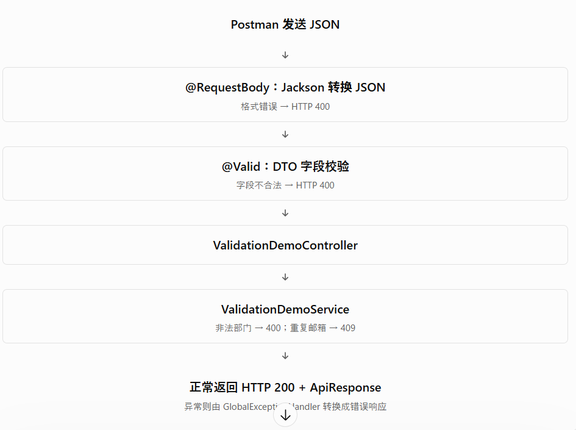

## @Validated
Spring 提供的注解，除了触发校验，还支持校验分组（Groups），也可用于启用 Spring 的方法级校验。
例如：
```
import jakarta.validation.constraints.Email;
import jakarta.validation.constraints.NotBlank;
import jakarta.validation.constraints.Size;

public class EmployeeRequest {

    @NotBlank(
        message = "新增时姓名不能为空",
        groups = CreateGroup.class//表示该约束只在指定 CreateGroup 校验组时生效。
    )
    private String name;

    @NotBlank(
        message = "新增时邮箱不能为空",
        groups = CreateGroup.class
    )
    @Email(
        message = "邮箱格式不正确",
        groups = {CreateGroup.class, UpdateGroup.class}
    )
    private String email;

    // getter、setter
}
```
```
import org.springframework.validation.annotation.Validated;

@RestController
@RequestMapping("/demo/group")
public class EmployeeGroupController {

    // 新增员工
    @PostMapping
    public String create(
            @Validated(CreateGroup.class)
            @RequestBody EmployeeRequest request) {

        return "新增成功";
    }

    // 修改员工
    @PutMapping
    public String update(
            @Validated(UpdateGroup.class)
            @RequestBody EmployeeRequest request) {

        return "修改成功";
    }
}
```
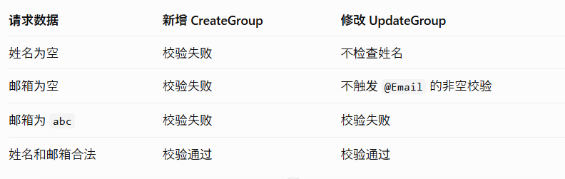

### @Validated 还可以用于 Service 方法校验
```
import jakarta.validation.constraints.Min;
import org.springframework.stereotype.Service;
import org.springframework.validation.annotation.Validated;

@Service
@Validated
public class EmployeeService {

    public String findById(
            @Min(value = 1, message = "员工ID必须大于等于1")
            Long id) {

        return "员工ID：" + id;
    }
}
```
放在 Service 类上，可以启用 Spring 的代理式方法校验。当其他 Spring Bean 通过代理调用就可以触发 @Min(1) 校验。

# 数据库记录怎样成为接口响应
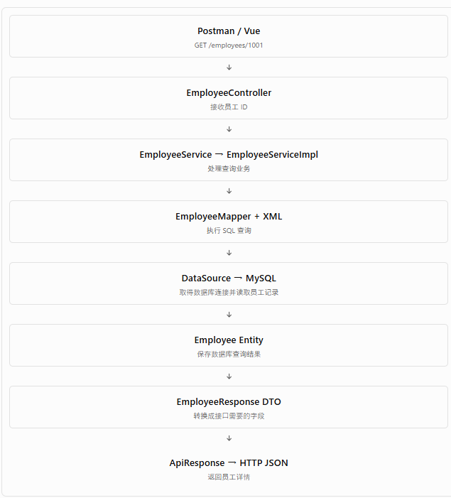
## DataSource 是什么？
DataSource 是 Java 获取数据库连接的入口。Spring Boot 需要访问 MySQL 时，通过 DataSource 获取数据库连接。
## Employee Entity 是什么？
Entity 用来表示数据库中的一条员工记录。
Entity 表示数据库数据，而 DTO 表示接口准备返回的数据。 两者不一定完全相同。
## EmployeeMapper 是什么？
Mapper 接口负责声明数据库操作
## EmployeeServiceImpl 为什么要存在？
Service 负责连接业务逻辑和数据库访问。
```
@Service
public class EmployeeServiceImpl implements EmployeeService {

    private final EmployeeMapper employeeMapper;

    public EmployeeServiceImpl(EmployeeMapper employeeMapper) {
        this.employeeMapper = employeeMapper;
    }

    @Override
    public EmployeeResponse getById(Long id) {

        Employee employee = employeeMapper.selectById(id);//第一步：查询数据库。

        if (employee == null) {
            throw new EmployeeNotFoundException("员工不存在：" + id);
        }

        return new EmployeeResponse(
                employee.getId(),
                employee.getName(),
                employee.getDepartment(),
                employee.getEmail()
        );//第二步：将 Entity 转换成响应 DTO。
    }
}
```

# 员工增删改查
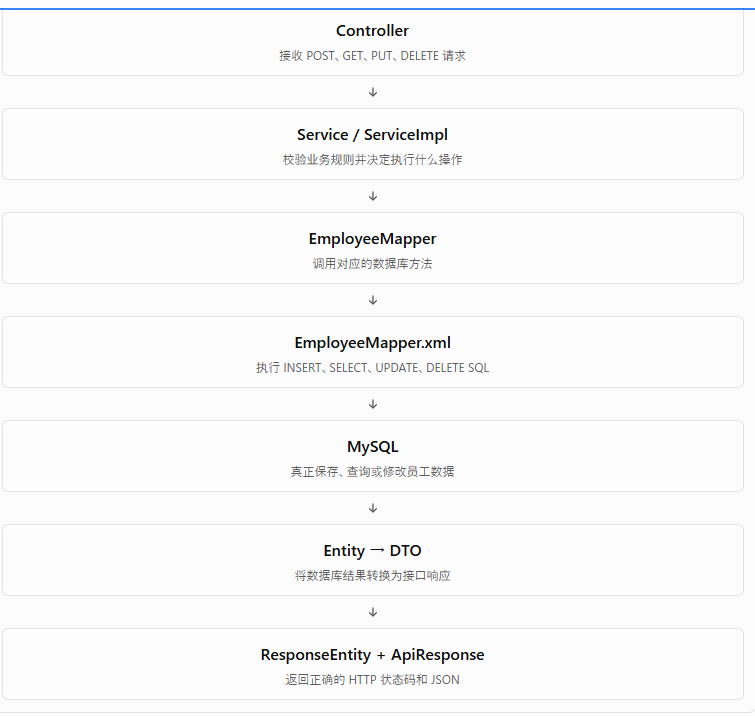
## EmployeeController.java：接收 HTTP 请求
```
@RestController
@RequestMapping("/employees")
public class EmployeeController {

    private final EmployeeService employeeService;

    public EmployeeController(EmployeeService employeeService) {
        this.employeeService = employeeService;
    }

    @GetMapping("/{id}")
    public ResponseEntity<ApiResponse<EmployeeResponse>> get(
            @PathVariable Long id) {

        return ResponseEntity.ok(
                ApiResponse.success(employeeService.getById(id))
        );
    }
}
```
## EmployeeService.java：定义业务接口
```
public interface EmployeeService {

    EmployeeResponse create(EmployeeCreateRequest request);

    EmployeeResponse getById(Long id);

    List<EmployeeListItemResponse> findAll(String department);

    EmployeeResponse update(Long id, EmployeeUpdateRequest request);

    void delete(Long id);
}
```
## EmployeeServiceImpl.java：真正的业务逻辑
```
@Service
public class EmployeeServiceImpl implements EmployeeService {

    private final EmployeeMapper mapper;

    public EmployeeServiceImpl(EmployeeMapper mapper) {
        this.mapper = mapper;
    }

    @Override
    public EmployeeResponse getById(Long id) {

        Employee employee = mapper.selectById(id);

        if (employee == null) {
            throw new EmployeeNotFoundException(id);
        }

        return toResponse(employee);
    }
}
```
## EmployeeMapper.java：声明 SQL 操作
```
@Mapper
public interface EmployeeMapper {

    Employee selectById(@Param("id") Long id);

    List<Employee> selectList(
            @Param("department") String department);

    Employee selectByEmail(@Param("email") String email);

    int insert(Employee employee);

    int update(Employee employee);

    int deleteById(@Param("id") Long id);
}
```
## EmployeeMapper.xml：真正执行 SQL
```
<select id="selectById" resultMap="employeeMap">
    SELECT
        id,
        name,
        department,
        email,
        status,
        created_at,
        updated_at
    FROM employees
    WHERE id = #{id}
</select>
```
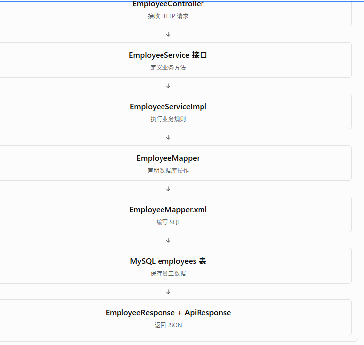

# 日志
## 什么时候记录日志
业务操作成功时：例如员工创建、修改、删除成功  
业务操作失败时：例如员工不存在、邮箱重复  
系统发生异常时：例如数据库连接失败、SQL 执行异常。  
HTTP 请求完成时：记录请求路径、状态码和耗时。  
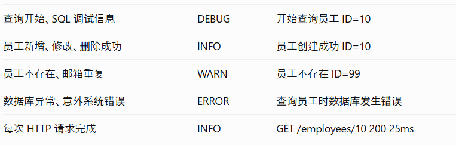
业务异常使用 WARN，系统异常使用 ERROR
### rollingpolicy：限制活动文件和历史文件
如果一直向同一个文件追加日志，文件会持续增大。滚动（rolling）是指达到条件后，把当前活动文件归档，再建立新的活动文件继续写入。

# Filter 与请求处理的执行时机 
## Filter 是什么
Filter（过滤器）是 Servlet 体系提供的请求处理机制。  
它可以在请求进入 Spring MVC 之前执行一些公共逻辑，例如：  
记录 HTTP 请求日志和耗时。  
设置 requestId，方便追踪请求。 
检查或处理请求信息。  
决定是否继续执行后续过滤器和 Controller。  
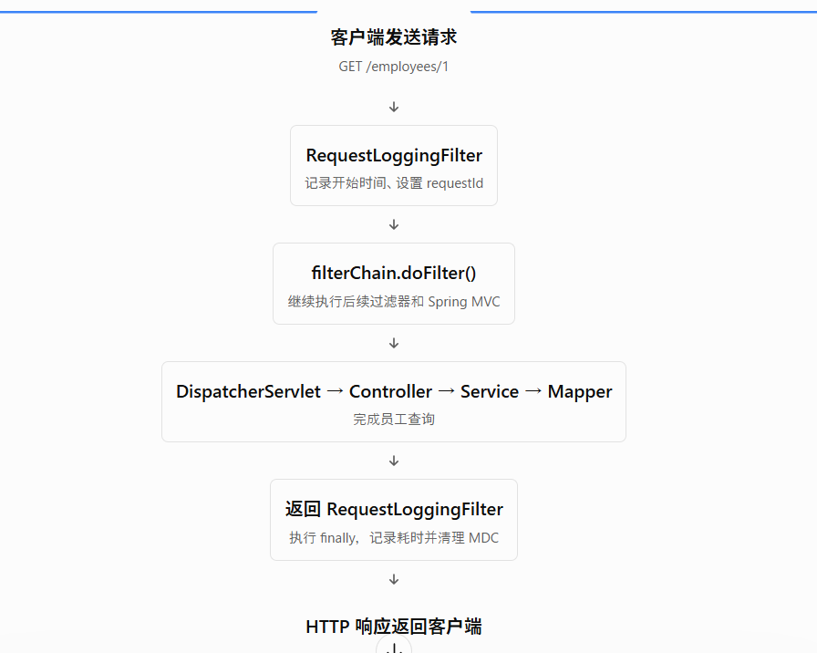
## filterChain.doFilter()  
